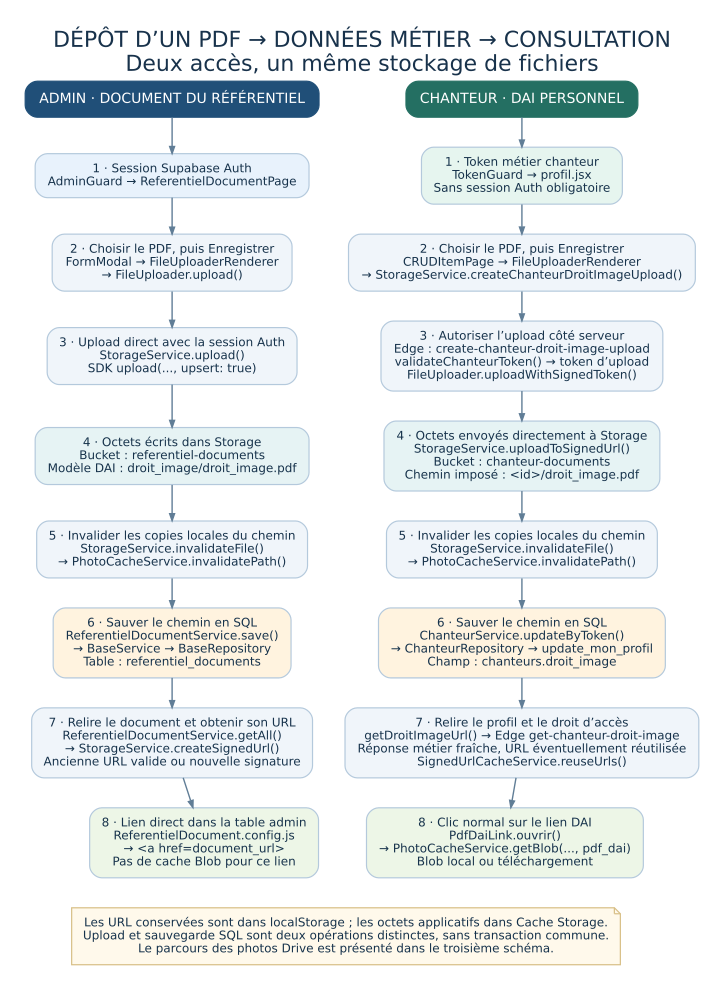
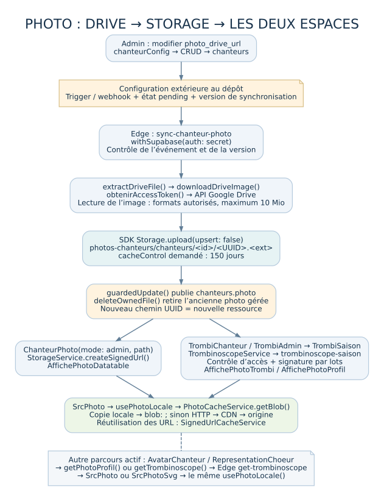
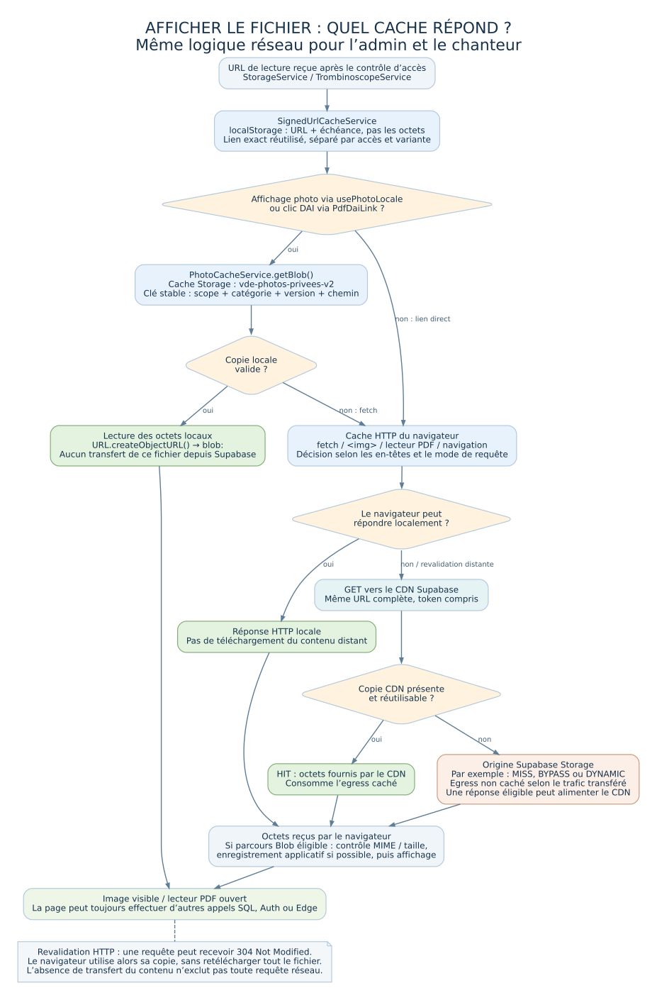

# Du fichier envoyé à son affichage : Storage, liens signés et caches

Document établi le **5 novembre 2026**, à partir du code de **`develop`, référence `77962d4`**. Les noms de fichiers, classes et fonctions correspondent à cette version. Les schémas décrivent le code de l’application ; les paramètres réellement appliqués sur les projets Supabase et les navigateurs restent à observer dans leurs interfaces.

Lecture conseillée : commencer par le schéma et les deux parcours parallèles, puis lire le détail des caches. L’index final permet de retrouver chaque maillon dans les sources.

## 1. Les trois choses qui circulent

| Élément | Exemple fictif | Où se trouve-t-il ? |
|---|---|---|
| **Le contenu du fichier** | Les octets d’un PDF ou d’une photo | Supabase Storage ; éventuellement copies dans le navigateur et le CDN |
| **Sa référence métier** | `chanteurs.droit_image = "<id>/droit_image.pdf"` | Base SQL Supabase ; elle indique quel fichier est associé à la personne |
| **Son autorisation de téléchargement** | `https://<projet>.supabase.co/storage/v1/object/sign/<bucket>/<chemin>?token=<signature>&v=1` | URL temporaire obtenue après contrôle d’accès, puis éventuellement conservée dans le navigateur |

**Enregistrer des octets dans Storage et enregistrer le chemin dans une table sont deux opérations différentes.** La première ne suffit pas à faire apparaître le document dans les écrans métier. Une URL signée permet de lire le fichier ; elle n’est pas le fichier lui-même.

Le client partagé est créé dans [`src/core/supabase/client.js`](https://github.com/iletaitunevoixdanslestasso-spec/vde/blob/77962d4/src/core/supabase/client.js) avec `createClient()`. Côté admin, le SDK utilise la session Supabase Auth. Côté chanteur, le token métier permet aux fonctions serveur de contrôler l’accès ; une session Supabase Auth n’est pas obligatoire pour cet espace.

## 2. Schéma des deux parcours en parallèle



Les deux colonnes utilisent le dépôt d’un PDF comme exemple. La colonne admin représente la création d’un document du référentiel, dont le modèle DAI ; la colonne chanteur représente son DAI personnel. **Les photos suivent la synchronisation Drive décrite en section 5**, et non ce sélecteur de PDF.

| Étape | Espace admin : document du référentiel | Espace chanteur : DAI personnel |
|---|---|---|
| 1. Entrer dans l’écran | `AdminGuard` dans [`src/core/auth/AdminGuard.jsx`](https://github.com/iletaitunevoixdanslestasso-spec/vde/blob/77962d4/src/core/auth/AdminGuard.jsx) vérifie la session. `/admin/documents` affiche `ReferentielDocumentPage` dans [`src/pages/admin/referentiels/ReferentielDocument/ReferentielDocumentPage.jsx`](https://github.com/iletaitunevoixdanslestasso-spec/vde/blob/77962d4/src/pages/admin/referentiels/ReferentielDocument/ReferentielDocumentPage.jsx). | `TokenGuard` dans [`src/core/auth/TokenGuard.jsx`](https://github.com/iletaitunevoixdanslestasso-spec/vde/blob/77962d4/src/core/auth/TokenGuard.jsx) appelle `getChanteurByToken()` dans [`src/core/supabase/chanteur.api.js`](https://github.com/iletaitunevoixdanslestasso-spec/vde/blob/77962d4/src/core/supabase/chanteur.api.js), vérifie la saison avec `getSaisonActive()`, puis initialise le contexte. Le profil est défini dans [`src/pages/chanteur/profil.jsx`](https://github.com/iletaitunevoixdanslestasso-spec/vde/blob/77962d4/src/pages/chanteur/profil.jsx). |
| 2. Définir le champ | `ReferentielDocumentConfig` dans [`src/config/entities/ReferentielDocument.config.js`](https://github.com/iletaitunevoixdanslestasso-spec/vde/blob/77962d4/src/config/entities/ReferentielDocument.config.js) définit `path`, type `fileUploader`, bucket `referentiel-documents`. `ReferentielDocumentController.prepareForm()` fournit notamment `droitImageTypeId`. | `profilConfig`, construit dans `profil.jsx` à partir de `chanteurConfig`, définit `droit_image`, bucket `chanteur-documents`, `signedUpload: true` et sélection PDF. |
| 3. Afficher le sélecteur | `FormModal` → `FormEdition` → `FieldRenderers.fileUploader` → `FileUploaderRenderer` → `FileUploader` → `FileRenderer`. `FileRenderer` lit le fichier sélectionné ; `FileUploader.handleFileChange()` le conserve en mémoire. | `CRUDItemPage` → `FormEdition` → le même `FieldRenderers.fileUploader`, `FileUploaderRenderer`, `FileUploader` et `FileRenderer`. |
| 4. Attendre « Enregistrer » | `FileUploaderRenderer.upload()` est enregistré auprès de `FormModal.registerFileUpload()`. Le bouton appelle `FormModal.handleSave()`, qui lance ce callback. | Le callback est enregistré auprès de `CRUDItemPage.registerFileUpload()`. Le bouton appelle `CRUDItemPage.handleSave()`, qui lance l’upload avant la sauvegarde du profil. |
| 5. Obtenir le droit d’écrire | `FileUploader.upload()` appelle `StorageService.upload()`. Le SDK transmet la session Auth ; les permissions Storage effectives sont appliquées par Supabase. | `FileUploaderRenderer.upload()` appelle d’abord `StorageService.createChanteurDroitImageUpload(context.token)` → `StorageService.callChanteurFunction()` → fonction `create-chanteur-droit-image-upload`. Elle valide le token métier et crée un **token d’upload**, distinct d’un lien de téléchargement. |
| 6. Choisir le chemin | `FileUploaderRenderer` choisit `droit_image/droit_image.pdf` pour le modèle DAI. Pour un nouveau document ordinaire, le nom du fichier est utilisé à la racine. La fonction de module `sanitizeFileName()` dans `StorageService.js` nettoie le nom final. | La fonction serveur impose `<id-chanteur>/droit_image.pdf`. `FileUploader.uploadWithSignedToken()` extrait ce chemin du token reçu ; ce chemin serveur fait autorité. |
| 7. Envoyer les octets | `StorageService.upload()` → `supabase.storage.from(bucket).upload(path, file, options)` avec `upsert: true`. | `FileUploader.uploadWithSignedToken()` → `StorageService.uploadToSignedUrl()` → `supabase.storage.from(bucket).uploadToSignedUrl(path, token, file, options)`. Les octets vont directement du navigateur à Storage, pas à travers l’Edge Function. |
| 8. Invalider les copies locales | Après succès : `StorageService.invalidateFile()` → `PhotoCacheService.invalidatePath()` → `SignedUrlCacheService.invalidatePath()` et retrait des blobs de ce chemin. | Même chaîne après succès de l’upload signé. Le token d’upload n’est pas réutilisé par le cache des liens de téléchargement. |
| 9. Enregistrer le chemin en SQL | `FormModal.handleSave()` récupère le résultat retourné par l’uploader et construit les champs `path` et `referentiel_documents_path`. Puis `CRUDPage.handleSave()` → `BaseController.save()` → `ReferentielDocumentService.save()` → `BaseService.save()` → validation, `BaseMapper.toDb()`, `BaseRepository.insert()` ou `update()` dans `referentiel_documents`. | `CRUDItemPage.handleSave()` supprime d’abord l’ancienne valeur `droit_image` de la copie du formulaire, puis y ajoute le nouveau chemin si l’upload en renvoie un. `BaseController.saveItemByToken()` → `ChanteurService.updateByToken()` actif → `ChanteurRepository.updateByToken()` → RPC SQL `update_mon_profil`, paramètre `p_droit_image`. |
| 10. Relire les données | Le rechargement passe par `BaseController.load()` → `ReferentielDocumentService.getAll()` → `ReferentielDocumentRepository.findAllNotDelete()`. Le service calcule `document_url` avec `StorageService.createSignedUrl()`. | `CRUDItemPage.load()` recharge le profil par `BaseController.loadItemByToken()` → `ChanteurService.getByToken()` → RPC `get_mon_profil`, puis enrichit les liens DAI avec `StorageService.getDroitImageUrl()`. |
| 11. Ouvrir le fichier | Dans la table du référentiel, `ReferentielDocument.config.js` fournit un lien `<a>` simple via `DataTable.renderValue()`. Il utilise le cache HTTP et le CDN, mais pas le cache Blob applicatif. | Le profil utilise `PdfDaiLink.ouvrir()` → `PhotoCacheService.getBlob(href, "pdf_dai")` sur clic gauche normal. Si un blob est disponible, le lecteur ouvre `blob:…` ; sinon il ouvre l’URL signée. |

### Précisions sur l’enregistrement

- Au premier chargement du profil, le `ChanteurProvider` actif de [`src/components/contexts/ChanteurContext.jsx`](https://github.com/iletaitunevoixdanslestasso-spec/vde/blob/77962d4/src/components/contexts/ChanteurContext.jsx) appelle `loadProfil()` → `BaseController.loadItemByToken()` → `ChanteurService.getByToken()`. Le formulaire utilise les données du contexte ; après sauvegarde, `CRUDItemPage.load()` les relit explicitement.
- `createEntityConfig()` dans [`src/config/entities/createEntityConfig.js`](https://github.com/iletaitunevoixdanslestasso-spec/vde/blob/77962d4/src/config/entities/createEntityConfig.js) assemble les instances `Repository`, `Validator`, `Mapper`, `Service` et `Controller` à partir de la configuration. Les classes `ReferentielDocumentMapper`, `ChanteurMapper` et `ChansonMapper` héritent de `BaseMapper` : `toDb()` exclut les colonnes calculées `mapped: false`, telles que les URL d’affichage.
- Pour le référentiel, `ReferentielDocumentService.save()` contrôle aussi l’unicité du type `droit_image`, avant `BaseService.save()`. Le contrôle intervient **après le transfert du fichier** dans le parcours du formulaire.
- `FileUploader.upload()` demande aussi une URL signée pour l’aperçu du résultat d’upload. Cette URL d’aperçu ne remplace pas la sauvegarde du chemin en SQL.
- Le chemin fiable pour la sauvegarde remonte dans **la valeur retournée** par le callback d’upload. Le callback `onUploaded` ne constitue pas cette sauvegarde SQL.
- Les deux transferts, Storage puis SQL, ne forment pas une transaction commune. Le client ne prévoit pas de rollback automatique du fichier si la sauvegarde SQL échoue. Si l’upload retourne `null`, le formulaire peut encore tenter de sauvegarder les autres champs ; il n’y a pas d’arrêt garanti sur ce seul retour.
- Le sélecteur propose des PDF (`accept`). Cela ne prouve pas les contraintes MIME ou de taille réellement configurées sur le bucket distant.
- Dans le formulaire référentiel, `path` et `document_type_id` sont `readonly` lors de l’édition d’un document existant : ce parcours décrit principalement la **création**. L’uploader de paroles d’une chanson reste modifiable.

## 3. Buckets, chemins et données métier

| Usage actif | Bucket | Chemin choisi par le code | Référence métier | Durée demandée à l’upload |
|---|---|---|---|---|
| Modèle de droit à l’image | `referentiel-documents` | `droit_image/droit_image.pdf` pour la création via le formulaire référentiel | `referentiel_documents.path`, type `document_types.code = droit_image` | `12960000` s, soit 150 jours |
| DAI personnel | `chanteur-documents` | `<id-chanteur>/droit_image.pdf`, imposé par le serveur | `chanteurs.droit_image`, via le RPC de profil | `12960000` s |
| Documents ordinaires du référentiel | `referentiel-documents` | Nom du fichier nettoyé ; pas de sous-dossier imposé par ce formulaire | `referentiel_documents.path`, `titre`, `document_type_id` | Pas de durée particulière ajoutée par `StorageService` pour ces catégories |
| Paroles d’une chanson | `referentiel-documents` | `paroles/<nom-nettoyé>` à la création ; chemin existant repris lors d’un remplacement | `referentiel_documents.path`, puis `chansons.paroles` contient l’ID du document | Pas de durée particulière ajoutée par ce circuit |
| Photo synchronisée depuis Drive | `photos-chanteurs` | `chanteurs/<id>/<UUID>.<extension>` | `chanteurs.photo` | `12960000` s |

`categorieStorage()` dans [`src/services/storageCachePolicy.js`](https://github.com/iletaitunevoixdanslestasso-spec/vde/blob/77962d4/src/services/storageCachePolicy.js) reconnaît les photos et certains chemins DAI ; un appelant peut aussi fournir explicitement la catégorie `pdf_dai`. Les autres documents ne prennent pas automatiquement la durée de 150 jours. Les valeurs existantes des objets ne sont pas modifiées par une simple publication du frontend.

`upsert: true` permet d’écraser un objet existant au même chemin. Les uploads de documents ordinaires ne génèrent pas d’UUID : deux créations au même chemin peuvent donc viser le même objet. La synchronisation Drive utilise, elle, un nouveau chemin UUID et `upsert: false`.

## 4. Variante admin : paroles, DAI personnel et validation

### Paroles

Entrée : `/admin/chansons`, `ChansonPage`, `chansonConfig` dans [`src/config/entities/chanson.config.js`](https://github.com/iletaitunevoixdanslestasso-spec/vde/blob/77962d4/src/config/entities/chanson.config.js).

Lors de la préparation du formulaire, `ChansonController.prepareForm()` appelle aussi `ChansonService.getAvailableReferentielDocumentParoles()` → `ReferentielDocumentRepository.findByCode("paroles")` pour son contexte. La configuration actuelle fournit ensuite le champ d’upload décrit ci-dessous.

1. Le champ `referentiel_documents` est un `fileUploader`, bucket `referentiel-documents`, `documentTypeCode: "paroles"`.
2. La chaîne `FormModal` → `FileUploaderRenderer` → `FileUploader.upload()` → `StorageService.upload()` transfère le PDF.
3. `FormModal.handleSave()` fournit `referentiel_documents_path`.
4. `ChansonService.save()` cherche le type `paroles` avec `DocumentTypeRepository.findByCode()`, puis appelle `ReferentielDocumentConfig.service.save()` pour créer ou mettre à jour la ligne du document.
5. Il affecte l’ID retourné à `chansons.paroles`, puis appelle `BaseService.save()` pour la chanson, avec `ChansonMapper` et `ChansonRepository`.
6. `ChansonService.getAll()` lit la jointure vers `referentiel_documents.path`, appelle `StorageService.createSignedUrl()`, puis remplit `paroles_url`. Le rendu de `chanson.config.js` produit un lien direct.

La variante par saison utilise `ChansonsSaisonPage` → `SaisonchansonService.getAll()` → `SaisonchansonRepository.findBySaison()` → `StorageService.createSignedUrl()`. `saisonchanson.config.js` ouvre le lien avec `window.open()`.

Les configurations de saison instancient `SaisonchansonController` et `ChanteursSaisonController`, qui héritent du chargement CRUD de `BaseController`. Pour les photos de la table de choristes, `ChanteurSaisonService.getAll()` appelle `ChanteurSaisonRepository.findBySaison()` ; la configuration rend le chemin `chanteurs.photo`.

Les champs `audio` et `audio_lead` de la configuration chanson sont des URL saisies directement. Ce parcours ne téléverse pas ces fichiers audio dans Supabase et n’impose pas son cache aux plateformes externes.

### DAI personnel consulté ou validé par l’admin

`ChanteurPage` → `chanteurConfig` → `ChanteurService.getAll()` lit `chanteur.droit_image` et demande `StorageService.createSignedUrl("chanteur-documents", path, 3600)`. Le champ calculé `droit_image_url` est rendu par `PdfDaiLink` : cette consultation peut donc utiliser le cache Blob DAI.

La configuration admin ne propose pas de sélecteur d’upload du DAI personnel. Les actions `ChanteurController.validateDroitImage()` et `rejectDroitImage()` passent par les méthodes homonymes de `ChanteurService`, puis `ChanteurRepository.updateDroitImageWorkflow()`. Elles fixent le workflow à `2` ou `3` ; elles ne remplacent pas le PDF et n’incrémentent pas la version du cache.

Les états affichés sont `0` non fourni, `1` à valider, `2` validé, `3` refusé. Le SQL de `update_mon_profil` et d’un éventuel trigger de remise à l’état `1` n’est pas fourni dans les migrations du dépôt : **le code client ne permet pas de certifier ce changement automatique après un upload**.

Sans nouveau PDF, le formulaire omet `droit_image` et le repository transmet `p_droit_image: null`. La conservation de l’ancien chemin dans ce cas dépend également du contrat SQL de `update_mon_profil`, non présent dans les sources examinées.

## 5. Variante photos : Google Drive → Storage → affichage

Dans `chanteur.config.js`, le champ `photo` est masqué dans le formulaire et `mapped: false`. L’admin peut modifier `photo_drive_url`. Le parcours métier recensé ne propose pas de sélecteur de fichier image pour alimenter directement `photo`.



| Étape | Fichier et fonction | Résultat |
|---|---|---|
| Enregistrer l’URL source | CRUD admin → `BaseController.save()` → `ChanteurService` / `BaseService.save()` → `ChanteurRepository` | Modification de `chanteurs.photo_drive_url` |
| Déclencher la synchronisation | Webhook/trigger Supabase **à configurer hors des sources présentes** | Appel de la fonction `sync-chanteur-photo` ; préparation attendue de `photo_sync_status = pending` et de la version de synchronisation |
| Contrôler l’événement | [`supabase/functions/sync-chanteur-photo/index.ts`](https://github.com/iletaitunevoixdanslestasso-spec/vde/blob/77962d4/supabase/functions/sync-chanteur-photo/index.ts), gestionnaire anonyme fourni à `withSupabase({ auth: "secret" }, …)` | Authentification du webhook, relecture du chanteur et vérification de la source/version attendue |
| Lire Drive | `extractDriveFile()` → `downloadDriveImage()` → `obtenirAccessToken()` dans [`supabase/functions/_shared/google-auth.ts`](https://github.com/iletaitunevoixdanslestasso-spec/vde/blob/77962d4/supabase/functions/_shared/google-auth.ts) | Lecture des métadonnées et des octets via l’API Drive ; formats image autorisés et plafond de 10 Mio dans la fonction |
| Écrire la photo | `.storage.from("photos-chanteurs").upload()` | Nouveau chemin `chanteurs/<id>/<UUID>.<extension>`, `upsert: false`, cache demandé de 150 jours |
| Publier le chemin métier | `guardedUpdate()` | Écriture conditionnelle de `chanteurs.photo`, de l’ID Drive et de l’état `ready`, sous contrôle de la version/source |
| Retirer l’ancien objet | `deleteOwnedFile()` | Suppression de l’ancienne photo possédée par ce mécanisme ; si l’écriture conditionnelle échoue, suppression du nouvel objet devenu inutile |

Le nouveau chemin UUID permet de distinguer la nouvelle photo des copies de l’ancienne. La fonction serveur n’appelle pas les helpers de cache du navigateur. Le branchement du webhook/trigger n’étant pas défini dans les migrations, la présence du fichier TypeScript ne prouve pas à elle seule que ce déclenchement est installé sur le projet.

Autre détail réel : si le même `photo_drive_id` est déjà associé, la fonction peut éviter un nouveau téléchargement. Remplacer le contenu du même fichier Drive n’est donc pas équivalent à fournir un nouvel ID Drive dans ce code.

### Affichage des photos, admin et chanteur

| Point d’entrée | Chaîne active jusqu’au cache d’octets |
|---|---|
| Table admin des adhérents | `chanteur.config.js` → `ChanteurPhoto(mode="admin", path)` → `StorageService.createSignedUrl()` → `AffichePhotoDatatable` → `SrcPhoto` → `usePhotoLocale()` → `PhotoCacheService.getBlob()` |
| Table admin de saison | `ChanteurSaisonRepository.findBySaison()` lit `chanteurs.photo` ; `chanteursSaison.config.js` utilise ensuite `ChanteurPhoto` et la même chaîne |
| Trombinoscope admin | `TrombiAdmin` → `TrombiSaison` → `TrombinoscopeService.getBySaisonId()` → fonction `trombinoscope-saison` → `AffichePhotoTrombi` ou `BlocInvite` / `AffichePhotoProfil` → `SrcPhoto` → `usePhotoLocale()` |
| Trombinoscope chanteur effectivement routé | `TrombiChanteur` → `TrombiSaison` → **la même** méthode `TrombinoscopeService.getBySaisonId()` et le même rendu |
| Avatar du profil / dashboard | `AvatarChanteur`, si une URL n’est pas déjà fournie → `StorageService.getPhotoProfil()` → `getTrombinoscope()` → `callChanteurFunction("get-trombinoscope", …)` → `AffichePhotoProfil` → `SrcPhoto` → `usePhotoLocale()` |
| Représentation SVG du chœur | `RepresentationChoeur` obtient les photos avec `StorageService.getTrombinoscope()` ; `AvatarChanteurSvg` → `SrcPhotoSvg` → `usePhotoLocale()` |

`trombinoscope-saison` contrôle la session Auth avec `adminValide()` ou le token métier avec `chanteurValide()` et le RPC `trombi_token_autorise(token, saisonId)`. Elle lit `vue_trombinoscope_saison`, enrichit le CA avec `chargerFonctionsCa()` / `ajouterFonctionCa()` de `_shared/trombinoscope-ca.ts`, puis `ajouterPhotosSignees()` signe les chemins distincts par lots de 100, pour 3600 secondes.

L’autre fonction, `get-trombinoscope`, reste active pour les avatars et la représentation SVG : elle s’appuie notamment sur le RPC `get_trombinoscope` et limite les chemins signés aux photos des identités autorisées. Elle n’est pas la fonction appelée par la route principale du trombinoscope.

## 6. Obtenir un lien de lecture : les deux scénarios

**Signer une URL ne télécharge pas encore le fichier.** L’appel SDK ou la fonction métier renvoie d’abord une chaîne de caractères. Le transfert des octets se produit quand `fetch`, ``, le lecteur PDF ou la navigation vers un lien utilise cette URL.

| Cas | Espace admin, signature directe | Espace chanteur / trombinoscope, fonction métier |
|---|---|---|
| Contrôle initial | La session Auth permet de lire les données métier et de demander une signature au SDK, selon les droits configurés | `callChanteurFunction()` ou `TrombinoscopeService.getBySaisonId()` appelle d’abord le serveur, qui valide l’accès et relit les données |
| Lien déjà conservé | `StorageService.createSignedUrl()` consulte `SignedUrlCacheService.get()` avec `[scope, bucket, path, expiresIn, version]` ; si valide, aucune nouvelle demande de signature directe | La réponse métier reste demandée. Elle peut contenir une nouvelle signature ; `SignedUrlCacheService.reuseUrls()` remplace seulement l’URL par une ancienne équivalente encore valide |
| Lien absent / trop proche de l’expiration | `supabase.storage.from(bucket).createSignedUrl()` fabrique une URL ; `versionnerUrl()` ajoute éventuellement `v` ; `reuseUrls()` rapproche les variantes puis `set()` conserve l’URL | Le serveur fournit une signature ; `reuseUrls()` conserve cette nouvelle URL si aucune précédente réutilisable n’existe |
| Métadonnées conservées | Le cache mémorise le lien et sa date limite, pas une ligne de profil ou de document complète | Chemin, liste de personnes/documents, workflow et erreurs restent ceux de la nouvelle réponse ; une URL absente n’est pas réinventée |

### DAI, modèle et documents chanteur

| Usage | Chaîne de lecture active | Contrôle / signature serveur | Dernier maillon UI |
|---|---|---|---|
| DAI personnel | `ChanteurService.getByToken()` → `StorageService.getDroitImageUrl(token, "get-chanteur-droit-image")` → `callChanteurFunction()` | `_shared/chanteur.ts` : `createSupabaseAdmin()` et `validateChanteurToken()` via `get_mon_profil` ; lecture de `chanteur.droit_image` ; `_shared/storage.ts` : `createSignedDownloadUrl()`, 3600 s, `download: true` | `profil.jsx` → `PdfDaiLink` |
| Modèle DAI | Même service avec `"get-chanteur-droit-image-template"` | Validation du token ; recherche du type `droit_image`, puis du document actif dans `referentiel_documents` ; même helper de signature, 3600 s, `download: true` | `profil.jsx` → `PdfDaiLink` |
| Documents ordinaires chanteur | `DocumentsChanteurPage` → `ReferentielDocumentController.loadDocumentsChanteur()` → `ReferentielDocumentService.findDocumentsChanteur()` → `StorageService.getChanteurDocuments()` → `callChanteurFunction()` | `get-chanteur-documents` valide le token, sélectionne les documents actifs de types **`choriste` et `adherent`**, puis signe chaque chemin 3600 s, `download: false` | `DocumentsChanteurPage` : liens `<a>` directs, propriété `downloadUrl` |
| Paroles chanteur | `ChansonsChanteur` → `saisonchanteurpupitreConfig.controller` → `SaisonChanteurPupitreController.getMesChansons()` → `SaisonChanteurPupitreService.getMesChansons()` dans [`src/services/SaisonchanteurpupitreService.js`](https://github.com/iletaitunevoixdanslestasso-spec/vde/blob/77962d4/src/services/SaisonchanteurpupitreService.js) → `StorageService.getChansonParoles()` → `callChanteurFunction()` | `get-chanteur-chanson-paroles` valide le token, lit la chanson active et son document lié de type `paroles`, puis signe 3600 s | `ChansonsChanteur` : lien direct |

`getDroitImageUrl()` ne mémorise pas une ancienne réponse métier entière : elle appelle la fonction à chaque lecture, avec déduplication des appels simultanés, puis retourne seulement son URL. Cela permet de détecter un document retiré ou un nouveau chemin. Le workflow affiché dans le profil vient du profil relu par le RPC `get_mon_profil`, transmis par `ChanteurService.getByToken()` ; cette méthode ne reprend pas le champ `workflow` de la réponse de signature.

Les deux fonctions DAI et les fonctions photo lisent aussi les catégories dans `_shared/storage-cache.ts` avec `readStorageCacheConfig()`, puis ajoutent la version à l’URL avec `versionStorageUrl()`.

### Les identités de cache

- Appel direct sous Auth : `admin-<UID>`, obtenu par `scopeUtilisateur()`.
- `callChanteurFunction()` : `chanteur-<SHA-256 du token explicitement passé>`, obtenu par `scopeTokenChanteur()`, même si une session admin est aussi présente.
- `TrombinoscopeService` et le cache Blob : Auth en priorité si une session existe, sinon empreinte du token métier.
- La séparation concerne les clés de cache. Le token métier est déjà mémorisé dans `localStorage["token"]` par `TokenGuard` et les **URL complètes, avec leur signature de téléchargement**, sont conservées dans le cache de liens. La clé serveur de service n’est pas envoyée au navigateur.

## 7. Quand les octets sont-ils réellement téléchargés ?



### Photos et clic DAI passant par le helper

1. `usePhotoLocale(url)` ou `PdfDaiLink.ouvrir()` demande `PhotoCacheService.getBlob()`.
2. `cheminPhotoSignee()` / le traitement `pdf_dai` vérifie l’origine, le bucket et le chemin. Le service résout le scope et la configuration de catégorie.
3. `cleCache()` construit une clé synthétique ; `lireImage()` cherche une réponse dans `Cache Storage → vde-photos-privees-v2` et vérifie les dates.
4. Si les octets sont valides, le service renvoie un `Blob`. `URL.createObjectURL(blob)` crée un lien **local** `blob:…`. Aucun téléchargement de ce fichier depuis Supabase n’est nécessaire.
5. Sinon, le service appelle `fetch(versionnerUrl(url, version), { mode: "cors", credentials: "omit", cache: "default" })`. Le cache HTTP du navigateur peut encore répondre. Pour le prochain téléchargement d’un chemin invalidé localement, le mode est `cache: "reload"`, puis le service revient à `"default"` ; ce changement ne purge pas globalement le CDN.
6. Si une requête réseau est nécessaire, elle atteint le CDN Supabase. `HIT` signifie réponse depuis le CDN ; `MISS` signifie qu’il a dû interroger l’origine. Une même URL favorise la réutilisation, mais une copie peut être absente dans cette région ou évincée.
7. Après un téléchargement réussi, le service vérifie le MIME, la taille et l’absence d’invalidation pendant l’attente. Il conserve les octets acceptés avec `cache.put()` et ses dates applicatives, puis retourne le Blob.
8. `usePhotoLocale()` attend ce résultat avant de fournir `src` : il évite de lancer en parallèle un premier GET `` avec l’URL distante. Au changement de photo ou au démontage, il révoque son URL `blob:`.

`SrcPhoto` rend le `` et un secours en cas d’absence/erreur ; `SrcPhotoSvg` fait de même avec `<image href=…>`. Les composants `AffichePhotoDatatable`, `AffichePhotoProfil` et `AffichePhotoTrombi` habillent cette même logique.

Les URL de transformation `/storage/v1/render/image/sign/…` sont prises en charge par le cache des **URL**, mais pas par `usePhotoLocale()` / `cheminPhotoSignee()`, qui reconnaissent actuellement les photos sous `/object/sign/photos-chanteurs/…`. Une image transformée suit donc directement le cache HTTP/CDN dans cette implémentation.

Pour le DAI, `PdfDaiLink.ouvrir()` ouvre d’abord une fenêtre vide sur le clic utilisateur, puis y place `blob:` ou l’URL signée de secours. L’URL Blob PDF est révoquée après une minute. Un clic modifié, le clic milieu ou une ouverture native peut suivre directement le lien sans passer par `getBlob()`.

### Documents ordinaires et autres liens directs

Le navigateur suit l’URL conservée du `<a>` ou de `window.open()` : **cache HTTP → éventuellement CDN → éventuellement origine**. Il ne faut pas ajouter mentalement une étape Cache Storage qui n’existe pas dans ce chemin.

Ainsi, un PDF ordinaire, des paroles, ou le modèle DAI ouvert depuis la table admin des documents peuvent réutiliser leur URL et bénéficier du cache HTTP/CDN **sans être mémorisés par `PhotoCacheService`**. Le même modèle ouvert depuis le profil chanteur via `PdfDaiLink` suit, lui, le parcours Blob DAI.

## 8. Les couches de cache, leurs contenus et leurs durées

| Couche | Contenu réel | Code / emplacement | Durée et limites | Évite quoi ? |
|---|---|---|---|---|
| Configuration de catégorie en mémoire | `code`, `cache_version`, `cache_seconds`, `updated_at` | `StorageCacheConfigService.entries`, dans la page JavaScript | 60 s ; `ingest()` peut la mettre à jour depuis une réponse métier | Une partie des lectures répétées de configuration |
| Liens signés partagés | Chaînes URL complètes et échéances, **aucun octet PDF/image** | `SignedUrlCacheService`, `localStorage["vde-signed-download-urls-v2"]` | Expiration réelle du token, marge de 30 s ; au plus 500 **entrées**, pas forcément 500 fichiers | Certaines demandes directes de signature ; surtout le changement inutile d’URL de téléchargement |
| Copies applicatives des fichiers | Octets image / PDF DAI, conservés comme réponses puis lus en Blob | `PhotoCacheService`, `Cache Storage → vde-photos-privees-v2` | Photos : `cache_seconds`, actuellement 150 jours. DAI : minimum entre configuration, 1 h et expiration du lien. Objets de plus de 8 Mio non enregistrés | Le téléchargement des octets depuis Supabase, même si la page relit des données métier |
| Cache HTTP du navigateur | Réponses HTTP gérées par le navigateur | Hors de `Cache Storage` ; décision de `fetch`, ``, navigation PDF… | En-têtes réels de la réponse, règles de fraîcheur et de validation du navigateur | Le transfert distant du contenu quand une copie HTTP peut répondre |
| CDN Supabase | Copies distantes de réponses Storage | Infrastructure Supabase / Cloudflare | Politique réelle du CDN, clé d’URL, présence dans un nœud, évictions ; le code client ne fixe pas une résidence garantie | Un transfert depuis l’origine ; le téléchargement depuis le CDN compte encore comme egress caché |
| Cache de l’application PWA | Ressources du frontend généré | [`vite.config.js`](https://github.com/iletaitunevoixdanslestasso-spec/vde/blob/77962d4/vite.config.js), Workbox généré et import de [`public/push-handlers.js`](https://github.com/iletaitunevoixdanslestasso-spec/vde/blob/77962d4/public/push-handlers.js) | Dépend du build / worker | Le rechargement de ressources de l’application ; aucune règle Supabase `runtimeCaching` n’est définie ici |

Le cache HTTP et Cache Storage sont distincts. L’API Cache n’applique pas automatiquement les règles `Cache-Control` : `PhotoCacheService` gère ses propres dates avec `X-VDE-Photo-Cached-At` et `X-VDE-Expires-At`. Voir [MDN : API Cache](https://developer.mozilla.org/en-US/docs/Web/API/Cache).

Le cache HTTP peut également **revalider** une copie : une requête réseau reçoit alors éventuellement `304 Not Modified`, et le navigateur réutilise les octets déjà présents sans retélécharger tout le fichier. « Pas de transfert du contenu » et « aucune requête réseau » ne désignent donc pas toujours le même résultat.

Une **durée de signature de 3600 s**, une **copie locale photo de 150 jours** et une **durée HTTP/CDN** ne désignent donc pas la même chose. Une photo déjà téléchargée peut être réutilisée localement après expiration de son ancien lien. Pour les DAI, le code limite aussi la copie applicative à l’échéance du lien fourni. Cela n’efface pas les fichiers déjà téléchargés ailleurs ou conservés par un lecteur.

Le nettoyage de `PhotoCacheService` est opportuniste : `nettoyerCache()` s’exécute pendant les accès, au plus une fois par minute. La lecture individuelle applique `cache_seconds`, mais ce nettoyage global utilise actuellement un plafond fixe de **150 jours pour les photos**, même si la valeur SQL était supérieure. Il n’y a pas de tâche autonome qui efface les copies quand l’application est fermée.

### Clés et synchronisation des liens

`describe()`, fonction locale du module `SignedUrlCacheService.js`, identifie l’origine Supabase, le chemin et les paramètres triés. **Seul `token` est retiré de la clé de rapprochement** : `v`, `download` et les transformations restent distincts. Seuls `/storage/v1/object/sign/…` et `/storage/v1/render/image/sign/…` sont éligibles ; les liens externes, publics et d’upload ne sont pas remplacés.

Les méthodes `get()`, `set()`, `reuseUrls()` et le getter `generation` synchronisent les données partagées avec `sync()`. `decode()`, `validEntry()`, `trim()` et `persist()` contrôlent les entrées et leur conservation. `expirationSignee()` décode le champ `exp` ; ce contrôle client n’est **pas** une vérification cryptographique du JWT et ne remplace pas les contrôles serveur.

Les invalidations utilisent aussi `localStorage["vde-signed-download-urls-epoch-v1"]`. `advanceEpoch()` publie une nouvelle révision ; `discardForEpoch()` et la génération permettent de refuser une réponse plus ancienne. Les onglets ouverts découvrent ces changements **lors de leur prochaine opération de cache** : ce mécanisme ne rafraîchit pas automatiquement une image déjà affichée. Le stockage partagé n’est pas une transaction générale entre toutes les fenêtres.

Origine signifie protocole + hôte + port : `http://localhost:5173` et le site publié ont des stockages différents. La réutilisation concerne le même profil navigateur et le même scope autorisé, pas d’autres appareils ou utilisateurs. Si le stockage est bloqué ou saturé, le service utilise un repli mémoire ; le partage inter-onglets n’est alors pas garanti.

Il n’existe pas de minuteur qui renouvelle à lui seul un `href` déjà présent dans la page. La marge de 30 s est contrôlée **au prochain appel du service**. Un lien affiché longtemps puis utilisé après expiration peut nécessiter de recharger les données.

## 9. Configuration, remplacement et invalidation

### Configuration de catégorie

`identity()`, fonction locale du module `StorageCacheConfigService.js`, choisit l’identité. `readConfig()` lit directement `public.storage_cache_config` sous Auth, ou appelle la fonction `storage-cache-config` pour un accès chanteur sans session Auth. `load()` déduplique et conserve les résultats 60 s ; `get()` fournit une catégorie ; `ingest()` reprend la configuration des réponses métier. `normalize()` contrôle les données et `latestRows()` empêche une version connue de diminuer.

Les deux codes sont `photos_choristes` et `pdf_dai`. Le SQL est dans [`supabase/migrations/20261104120000_storage_cache_config.sql`](https://github.com/iletaitunevoixdanslestasso-spec/vde/blob/77962d4/supabase/migrations/20261104120000_storage_cache_config.sql). La table et la fonction HTTP `/functions/v1/storage-cache-config` sont deux objets différents : créer la table ne déploie pas l’Edge Function.

Une lecture facultative en erreur utilise la dernière configuration ou les valeurs par défaut ; le mode `strict` expose l’erreur. Certaines fonctions métier serveur exigent, elles, que la configuration SQL existe pour construire leur réponse.

### Effet exact des actions

| Action | Liens et octets dans ce navigateur / cette origine | Serveur, autres appareils et CDN |
|---|---|---|
| `StorageService.upload()` ou `uploadToSignedUrl()` réussit | `invalidateFile()` → `PhotoCacheService.invalidatePath()` : retire les variantes du chemin dans le cache de liens partagé et les blobs correspondants ; les réponses commencées avant l’invalidation ne repeuplent pas les caches, et certains services écartent aussi leur résultat | L’objet est écrit dans Storage. **La version de toute la catégorie n’est pas incrémentée automatiquement** |
| `StorageService.remove()` réussit | Même invalidation du chemin | Suppression de l’objet. `ReferentielDocumentService.delete()` retire ensuite logiquement la ligne SQL ; ce sont encore deux opérations |
| `PhotoCacheService.invalidateChanteur(id)` | `SignedUrlCacheService.invalidatePrefix()` et suppression des blobs de ses photos | Helper disponible ; aucun appel de ce helper n’a été trouvé dans les parcours métier courants. Ne pas le supposer exécuté par le webhook Drive |
| Nouvelle photo Drive | Aucune commande de purge navigateur envoyée par l’Edge Function | Un nouveau chemin UUID est publié ; lors de la relecture métier, il désigne naturellement une autre ressource |
| Déconnexion / changement de compte Auth | Listener `supabase.auth.onAuthStateChange()` dans `StorageService` → `PhotoCacheService.clearAll()` → suppression du cache Blob et des URL partagées, conservation de la barrière d’invalidation | Les copies sur d’autres appareils ne sont pas effacées par ce JavaScript |
| Changement de token métier chanteur | `TokenGuard` appelle `PhotoCacheService.clearAll()` avant de mémoriser le nouveau token | Les autres scopes restent soumis à leur propre validation serveur |
| Clic admin « Actualiser le cache » | `StorageCacheAdminPage` → `StorageCacheConfigService.refresh(code)` ; nouvelle version connue, nouvelles clés Blob et paramètre `v` | L’Edge `storage-cache-config` vérifie le JWT et l’UID autorisé par `PUSH_ADMIN_USER_IDS`, puis appelle le RPC `increment_storage_cache_version(code)` réservé au rôle serveur |
| Suppression du seul cache `vde-photos-privees-v2` | Les octets applicatifs sont retirés ; les URL en `localStorage` et le cache HTTP peuvent encore exister | Aucune purge CDN |
| Effacement des données du site | Supprime aussi les liens conservés et les autres données locales selon l’action choisie dans le navigateur | Aucune suppression des objets Storage ni purge générale du CDN |

`StorageCacheAdminPage` sépare la lecture de configuration et le contrôle du droit d’actualisation avec `checkRefreshPermission()`. Une fonction de gestion indisponible n’empêche pas d’afficher la configuration SQL déjà lue sous Auth.

Les autres navigateurs / appareils prennent la nouvelle version lorsqu’ils rechargent leur configuration, normalement après expiration des 60 s ou par une réponse métier. Une image déjà affichée n’est pas remplacée spontanément. Les anciens blobs et versions sont nettoyés pendant l’usage ; incrémenter `v` n’est pas une commande de purge de toutes les copies CDN.

## 10. Ce que prouve un HIT et comment vérifier

Un `CF-Cache-Status: HIT` sur une **vraie réponse réseau** prouve que cette requête a reçu les octets du CDN. `MISS` indique une interrogation de l’origine pour cette requête. Une réponse « cache mémoire/disque » ou une URL `blob:` prouve un usage local ; elle ne constitue pas un nouveau HIT CDN. Voir [Supabase : fonctionnement du CDN](https://supabase.com/docs/guides/storage/cdn/fundamentals).

Avec Smart CDN, deux tokens de téléchargement différents créent des entrées distinctes. Réutiliser la même URL évite de fabriquer systématiquement une entrée froide ; cela ne garantit pas qu’une copie soit présente dans chaque région. Le Smart CDN est annoncé par Supabase pour Pro et plus ; le plan Free possède un CDN de base. L’en-tête observé dans cette conversation `x-smart-cdn: true` ne suffit pas à déduire le plan ou la configuration de tous les projets. Voir [Supabase : URL signées et Smart CDN](https://supabase.com/docs/guides/storage/cdn/smart-cdn#signed-urls-and-cdn-caching).

Les 150 jours demandés lors de certains uploads ne sont ni une preuve de HIT ni une garantie de présence pendant 150 jours sur le CDN. Un déploiement frontend ne réécrit pas les en-têtes des anciens objets ; le helper de migration [`scripts/storage-cache-migration.mjs`](https://github.com/iletaitunevoixdanslestasso-spec/vde/blob/77962d4/scripts/storage-cache-migration.mjs), décrit dans [storage-cache.md](storage-cache.md), est une opération séparée.

### Vérification pratique, sans changer le code

1. Dans les outils navigateur, regarder séparément `localStorage` (URL), `Cache Storage → vde-photos-privees-v2` (octets) et Réseau (transferts).
2. Charger une photo normalement, sans « Désactiver le cache » et sans rechargement forcé. Au deuxième affichage, le cache Blob peut éviter tout GET de cette photo ; les requêtes de données métier peuvent continuer.
3. Ouvrir un deuxième onglet sur la même origine et le même accès. Si un GET du fichier est nécessaire, son URL signée doit pouvoir rester identique tant qu’elle est réutilisable. Une lecture locale HTTP/Blob peut encore éviter le GET.
4. Pour isoler le CDN, copier uniquement une URL signée encore valide puis, dans PowerShell, exécuter deux fois un GET identique :

```powershell
$urlStorage = (Get-Clipboard -Raw).Trim()
curl.exe -sS -D - -o NUL "$urlStorage"
curl.exe -sS -D - -o NUL "$urlStorage"
```

5. Lire `CF-Cache-Status` et éventuellement `Age`. Ne pas utiliser `curl -I` pour ce test : cela envoie `HEAD`, que Smart CDN ne met pas en cache comme un GET. Choisir un petit fichier : ces commandes téléchargent réellement ses octets.
6. Les logs Supabase permettent de retrouver les requêtes Storage et leurs HIT/MISS. Ils ne constituent pas l’inventaire en temps réel de tous les objets présents dans tous les nœuds CDN. Voir [métriques CDN](https://supabase.com/docs/guides/storage/cdn/metrics).

**Effet sur l’egress :** une lecture des octets déjà présents localement évite ce transfert de fichier. Un GET servi par le CDN consomme encore l’egress caché. Un GET servi depuis l’origine consomme l’egress non caché. Les petits appels Auth, SQL, de signature ou de fonctions continuent à pouvoir produire leur propre egress ; le cache d’une photo ne rend pas toute la page gratuite en transferts.

## 11. Périmètre vérifié et limites à connaître

Le présent document n’ajoute pas de comportement à l’application. Il s’appuie sur les chemins réellement appelés et signale les frontières suivantes :

- La visibilité effective des buckets, leurs policies Storage, les corps SQL des RPC de profil et le raccordement du webhook Drive ne sont pas tous fournis par les migrations présentes. Le client et les fonctions sont décrits ; une configuration distante non lue n’est pas certifiée.
- La lecture RLS de `storage_cache_config` ne donne pas, à elle seule, accès aux objets d’un bucket. Les droits de table, le contrôle de l’Edge Function et la signature de téléchargement sont des contrôles distincts.
- `trombinoscope-saison` valide l’accès chanteur à la saison exacte via `trombi_token_autorise`. La fonction de paroles valide le token et le document, mais on ne lui attribue pas un contrôle explicite chanson/saison absent de son code.
- `ChanteurService` contient deux définitions de `updateByToken()` ; la seconde est celle exécutée en JavaScript. Le code placé après le premier `return` de `ReferentielDocumentService.findDocumentsChanteur()` est inaccessible. Les variantes `*_old`, pages de test et l’ancien [`src/pages/chanteur/Trombinoscope.jsx`](https://github.com/iletaitunevoixdanslestasso-spec/vde/blob/77962d4/src/pages/chanteur/Trombinoscope.jsx) non routé ne sont pas les chaînes métier principales décrites ici.
- `FileUploaderRenderer.onUploaded` appelle `onChange` avec une signature différente de celle attendue par les formulaires. La chaîne décrite repose sur le résultat d’upload explicitement réassemblé par `handleSave()`, pas sur l’hypothèse que ce callback sauvegarderait correctement le chemin.
- Les règles de signature ne rendent pas révocables à distance les octets déjà téléchargés. Les blobs photo peuvent survivre à une signature ; le cache HTTP et le CDN ont aussi leurs propres politiques. La limite locale d’une heure des DAI n’est pas une garantie d’effacement de toutes les copies.
- La documentation Smart CDN précise qu’une réponse déjà en cache peut encore être servie pour la même URL après expiration de son token, jusqu’à l’échéance de cette copie CDN. L’expiration du token ne purge donc pas cette copie. L’application, elle, cesse de réutiliser ses liens conservés avant leur expiration. Voir [Supabase : expiration des URL signées et cache](https://supabase.com/docs/guides/storage/cdn/smart-cdn#signed-urls-and-cdn-caching).
- Aucune mesure de baisse d’egress ni aucun taux de HIT de production ne découle de la seule lecture du code. Les en-têtes et métriques réels sont nécessaires.

## 12. Index des sources : fichiers, classes et fonctions

Les liens ci-dessous pointent sur le code `77962d4`. `Deno.serve(…)` désigne un gestionnaire anonyme, pas une classe inventée portant le nom de l’endpoint. Les méthodes Supabase SDK mentionnées dans le document sont fournies par la dépendance `@supabase/supabase-js`.

| Fichier | Rôle | Fonctions / points de passage |
|---|---|---|
| [`src/app/router.jsx`](https://github.com/iletaitunevoixdanslestasso-spec/vde/blob/77962d4/src/app/router.jsx) | Routes actives | [`Router`](https://github.com/iletaitunevoixdanslestasso-spec/vde/blob/77962d4/src/app/router.jsx#L88) |
| [`src/core/supabase/client.js`](https://github.com/iletaitunevoixdanslestasso-spec/vde/blob/77962d4/src/core/supabase/client.js) | Client partagé | [`createClient`](https://github.com/iletaitunevoixdanslestasso-spec/vde/blob/77962d4/src/core/supabase/client.js#L11) |
| [`src/core/auth/AdminGuard.jsx`](https://github.com/iletaitunevoixdanslestasso-spec/vde/blob/77962d4/src/core/auth/AdminGuard.jsx) | Accès admin | [`AdminGuard`](https://github.com/iletaitunevoixdanslestasso-spec/vde/blob/77962d4/src/core/auth/AdminGuard.jsx#L5) |
| [`src/core/auth/TokenGuard.jsx`](https://github.com/iletaitunevoixdanslestasso-spec/vde/blob/77962d4/src/core/auth/TokenGuard.jsx) | Accès chanteur | [`TokenGuard`](https://github.com/iletaitunevoixdanslestasso-spec/vde/blob/77962d4/src/core/auth/TokenGuard.jsx#L8) · [`check`](https://github.com/iletaitunevoixdanslestasso-spec/vde/blob/77962d4/src/core/auth/TokenGuard.jsx#L18) |
| [`src/core/supabase/chanteur.api.js`](https://github.com/iletaitunevoixdanslestasso-spec/vde/blob/77962d4/src/core/supabase/chanteur.api.js) | Validation d’entrée chanteur | [`getChanteurByToken`](https://github.com/iletaitunevoixdanslestasso-spec/vde/blob/77962d4/src/core/supabase/chanteur.api.js#L36) |
| [`src/core/supabase/saison.api.js`](https://github.com/iletaitunevoixdanslestasso-spec/vde/blob/77962d4/src/core/supabase/saison.api.js) | Saison active | [`getSaisonActive`](https://github.com/iletaitunevoixdanslestasso-spec/vde/blob/77962d4/src/core/supabase/saison.api.js#L2) |
| [`src/components/contexts/ChanteurContext.jsx`](https://github.com/iletaitunevoixdanslestasso-spec/vde/blob/77962d4/src/components/contexts/ChanteurContext.jsx) | Contexte profil actif | [`ChanteurProvider`](https://github.com/iletaitunevoixdanslestasso-spec/vde/blob/77962d4/src/components/contexts/ChanteurContext.jsx#L79) · [`loadProfil`](https://github.com/iletaitunevoixdanslestasso-spec/vde/blob/77962d4/src/components/contexts/ChanteurContext.jsx#L97) · [`useChanteur`](https://github.com/iletaitunevoixdanslestasso-spec/vde/blob/77962d4/src/components/contexts/ChanteurContext.jsx#L159) |
| [`src/config/entities/createEntityConfig.js`](https://github.com/iletaitunevoixdanslestasso-spec/vde/blob/77962d4/src/config/entities/createEntityConfig.js) | Assemblage métier | [`createEntityConfig`](https://github.com/iletaitunevoixdanslestasso-spec/vde/blob/77962d4/src/config/entities/createEntityConfig.js#L15) |
| [`src/config/entities/ReferentielDocument.config.js`](https://github.com/iletaitunevoixdanslestasso-spec/vde/blob/77962d4/src/config/entities/ReferentielDocument.config.js) | Champs et rendu référentiel | [`ReferentielDocumentConfig`](https://github.com/iletaitunevoixdanslestasso-spec/vde/blob/77962d4/src/config/entities/ReferentielDocument.config.js#L80) |
| [`src/config/entities/chanteur.config.js`](https://github.com/iletaitunevoixdanslestasso-spec/vde/blob/77962d4/src/config/entities/chanteur.config.js) | DAI, photo et actions admin | [`chanteurConfig`](https://github.com/iletaitunevoixdanslestasso-spec/vde/blob/77962d4/src/config/entities/chanteur.config.js#L132) |
| [`src/config/entities/chanson.config.js`](https://github.com/iletaitunevoixdanslestasso-spec/vde/blob/77962d4/src/config/entities/chanson.config.js) | Upload paroles et liens | [`chansonConfig`](https://github.com/iletaitunevoixdanslestasso-spec/vde/blob/77962d4/src/config/entities/chanson.config.js#L121) |
| [`src/config/entities/saisonchanson.config.js`](https://github.com/iletaitunevoixdanslestasso-spec/vde/blob/77962d4/src/config/entities/saisonchanson.config.js) | Liens paroles par saison | [`saisonchansonConfig`](https://github.com/iletaitunevoixdanslestasso-spec/vde/blob/77962d4/src/config/entities/saisonchanson.config.js#L96) |
| [`src/config/entities/chanteursSaison.config.js`](https://github.com/iletaitunevoixdanslestasso-spec/vde/blob/77962d4/src/config/entities/chanteursSaison.config.js) | Photo de table saison | [`ChanteursSaisonConfig`](https://github.com/iletaitunevoixdanslestasso-spec/vde/blob/77962d4/src/config/entities/chanteursSaison.config.js#L197) |
| [`src/config/entities/saisonchanteurpupitre.config.js`](https://github.com/iletaitunevoixdanslestasso-spec/vde/blob/77962d4/src/config/entities/saisonchanteurpupitre.config.js) | Contrôleur chansons côté chanteur | [`saisonchanteurpupitreConfig`](https://github.com/iletaitunevoixdanslestasso-spec/vde/blob/77962d4/src/config/entities/saisonchanteurpupitre.config.js#L20) |
| [`src/pages/admin/referentiels/ReferentielDocument/ReferentielDocumentPage.jsx`](https://github.com/iletaitunevoixdanslestasso-spec/vde/blob/77962d4/src/pages/admin/referentiels/ReferentielDocument/ReferentielDocumentPage.jsx) | Écran documents | [`ReferentielDocumentPage`](https://github.com/iletaitunevoixdanslestasso-spec/vde/blob/77962d4/src/pages/admin/referentiels/ReferentielDocument/ReferentielDocumentPage.jsx#L7) |
| [`src/pages/admin/referentiels/chansons/ChansonPage.jsx`](https://github.com/iletaitunevoixdanslestasso-spec/vde/blob/77962d4/src/pages/admin/referentiels/chansons/ChansonPage.jsx) | Écran chansons | [`ChansonPage`](https://github.com/iletaitunevoixdanslestasso-spec/vde/blob/77962d4/src/pages/admin/referentiels/chansons/ChansonPage.jsx#L8) |
| [`src/pages/admin/referentiels/chanteurs/ChanteurPage.jsx`](https://github.com/iletaitunevoixdanslestasso-spec/vde/blob/77962d4/src/pages/admin/referentiels/chanteurs/ChanteurPage.jsx) | Écran adhérents | [`ChanteurPage`](https://github.com/iletaitunevoixdanslestasso-spec/vde/blob/77962d4/src/pages/admin/referentiels/chanteurs/ChanteurPage.jsx#L10) |
| [`src/pages/admin/saisons/ChanteurSaisonPage.jsx`](https://github.com/iletaitunevoixdanslestasso-spec/vde/blob/77962d4/src/pages/admin/saisons/ChanteurSaisonPage.jsx) | Écran choristes de saison | [`ChanteurSaisonPage`](https://github.com/iletaitunevoixdanslestasso-spec/vde/blob/77962d4/src/pages/admin/saisons/ChanteurSaisonPage.jsx#L13) |
| [`src/pages/admin/saisons/ChansonsSaisonPage.jsx`](https://github.com/iletaitunevoixdanslestasso-spec/vde/blob/77962d4/src/pages/admin/saisons/ChansonsSaisonPage.jsx) | Écran chansons de saison | [`ChansonsSaisonPage`](https://github.com/iletaitunevoixdanslestasso-spec/vde/blob/77962d4/src/pages/admin/saisons/ChansonsSaisonPage.jsx#L14) |
| [`src/pages/chanteur/profil.jsx`](https://github.com/iletaitunevoixdanslestasso-spec/vde/blob/77962d4/src/pages/chanteur/profil.jsx) | Formulaire DAI et liens | [`ChanteurPage`](https://github.com/iletaitunevoixdanslestasso-spec/vde/blob/77962d4/src/pages/chanteur/profil.jsx#L129) |
| [`src/pages/chanteur/DocumentsChanteurPage.jsx`](https://github.com/iletaitunevoixdanslestasso-spec/vde/blob/77962d4/src/pages/chanteur/DocumentsChanteurPage.jsx) | Liens directs des documents | [`DocumentsChanteurPage`](https://github.com/iletaitunevoixdanslestasso-spec/vde/blob/77962d4/src/pages/chanteur/DocumentsChanteurPage.jsx#L12) |
| [`src/pages/chanteur/ChansonsChanteur.jsx`](https://github.com/iletaitunevoixdanslestasso-spec/vde/blob/77962d4/src/pages/chanteur/ChansonsChanteur.jsx) | Liens directs des paroles | [`ChansonsChanteur`](https://github.com/iletaitunevoixdanslestasso-spec/vde/blob/77962d4/src/pages/chanteur/ChansonsChanteur.jsx#L22) |
| [`src/framework/crud/CRUDPage.jsx`](https://github.com/iletaitunevoixdanslestasso-spec/vde/blob/77962d4/src/framework/crud/CRUDPage.jsx) | Formulaire admin | [`CRUDPage`](https://github.com/iletaitunevoixdanslestasso-spec/vde/blob/77962d4/src/framework/crud/CRUDPage.jsx#L12) · [`handleAdd`](https://github.com/iletaitunevoixdanslestasso-spec/vde/blob/77962d4/src/framework/crud/CRUDPage.jsx#L244) · [`handleSave`](https://github.com/iletaitunevoixdanslestasso-spec/vde/blob/77962d4/src/framework/crud/CRUDPage.jsx#L265) |
| [`src/framework/crud/CRUDItemPage.jsx`](https://github.com/iletaitunevoixdanslestasso-spec/vde/blob/77962d4/src/framework/crud/CRUDItemPage.jsx) | Formulaire profil | [`CRUDItemPage`](https://github.com/iletaitunevoixdanslestasso-spec/vde/blob/77962d4/src/framework/crud/CRUDItemPage.jsx#L7) · [`registerFileUpload`](https://github.com/iletaitunevoixdanslestasso-spec/vde/blob/77962d4/src/framework/crud/CRUDItemPage.jsx#L29) · [`handleSave`](https://github.com/iletaitunevoixdanslestasso-spec/vde/blob/77962d4/src/framework/crud/CRUDItemPage.jsx#L149) · [`load`](https://github.com/iletaitunevoixdanslestasso-spec/vde/blob/77962d4/src/framework/crud/CRUDItemPage.jsx#L64) |
| [`src/framework/form/FormModal.jsx`](https://github.com/iletaitunevoixdanslestasso-spec/vde/blob/77962d4/src/framework/form/FormModal.jsx) | Upload différé admin | [`FormModal`](https://github.com/iletaitunevoixdanslestasso-spec/vde/blob/77962d4/src/framework/form/FormModal.jsx#L7) · [`registerFileUpload`](https://github.com/iletaitunevoixdanslestasso-spec/vde/blob/77962d4/src/framework/form/FormModal.jsx#L24) · [`handleSave`](https://github.com/iletaitunevoixdanslestasso-spec/vde/blob/77962d4/src/framework/form/FormModal.jsx#L76) |
| [`src/framework/form/FormEdition.jsx`](https://github.com/iletaitunevoixdanslestasso-spec/vde/blob/77962d4/src/framework/form/FormEdition.jsx) | Choix des renderers | [`FormEdition`](https://github.com/iletaitunevoixdanslestasso-spec/vde/blob/77962d4/src/framework/form/FormEdition.jsx#L4) |
| [`src/framework/form/FieldRenderers.js`](https://github.com/iletaitunevoixdanslestasso-spec/vde/blob/77962d4/src/framework/form/FieldRenderers.js) | Registre des renderers | [`FieldRenderers`](https://github.com/iletaitunevoixdanslestasso-spec/vde/blob/77962d4/src/framework/form/FieldRenderers.js#L14) |
| [`src/framework/form/renderers/FileRenderer.jsx`](https://github.com/iletaitunevoixdanslestasso-spec/vde/blob/77962d4/src/framework/form/renderers/FileRenderer.jsx) | Sélection du fichier | [`FileRenderer`](https://github.com/iletaitunevoixdanslestasso-spec/vde/blob/77962d4/src/framework/form/renderers/FileRenderer.jsx#L1) |
| [`src/framework/form/renderers/FileUploaderRenderer.jsx`](https://github.com/iletaitunevoixdanslestasso-spec/vde/blob/77962d4/src/framework/form/renderers/FileUploaderRenderer.jsx) | Choix admin / upload signé | [`FileUploaderRenderer`](https://github.com/iletaitunevoixdanslestasso-spec/vde/blob/77962d4/src/framework/form/renderers/FileUploaderRenderer.jsx#L11) · [`upload`](https://github.com/iletaitunevoixdanslestasso-spec/vde/blob/77962d4/src/framework/form/renderers/FileUploaderRenderer.jsx#L22) |
| [`src/core/framework/FileUploader.jsx`](https://github.com/iletaitunevoixdanslestasso-spec/vde/blob/77962d4/src/core/framework/FileUploader.jsx) | Transfert et résultat retourné | [`FileUploader`](https://github.com/iletaitunevoixdanslestasso-spec/vde/blob/77962d4/src/core/framework/FileUploader.jsx#L11) · [`handleFileChange`](https://github.com/iletaitunevoixdanslestasso-spec/vde/blob/77962d4/src/core/framework/FileUploader.jsx#L31) · [`upload`](https://github.com/iletaitunevoixdanslestasso-spec/vde/blob/77962d4/src/core/framework/FileUploader.jsx#L60) · [`uploadWithSignedToken`](https://github.com/iletaitunevoixdanslestasso-spec/vde/blob/77962d4/src/core/framework/FileUploader.jsx#L192) |
| [`src/framework/table/DataTable.jsx`](https://github.com/iletaitunevoixdanslestasso-spec/vde/blob/77962d4/src/framework/table/DataTable.jsx) | Rendu des colonnes | [`DataTable`](https://github.com/iletaitunevoixdanslestasso-spec/vde/blob/77962d4/src/framework/table/DataTable.jsx#L4) · [`renderValue`](https://github.com/iletaitunevoixdanslestasso-spec/vde/blob/77962d4/src/framework/table/DataTable.jsx#L437) |
| [`src/controllers/BaseController.js`](https://github.com/iletaitunevoixdanslestasso-spec/vde/blob/77962d4/src/controllers/BaseController.js) | Contrôle CRUD commun | [`initialize`](https://github.com/iletaitunevoixdanslestasso-spec/vde/blob/77962d4/src/controllers/BaseController.js#L8) · [`load`](https://github.com/iletaitunevoixdanslestasso-spec/vde/blob/77962d4/src/controllers/BaseController.js#L56) · [`save`](https://github.com/iletaitunevoixdanslestasso-spec/vde/blob/77962d4/src/controllers/BaseController.js#L66) · [`handle`](https://github.com/iletaitunevoixdanslestasso-spec/vde/blob/77962d4/src/controllers/BaseController.js#L43) · [`loadItemByToken`](https://github.com/iletaitunevoixdanslestasso-spec/vde/blob/77962d4/src/controllers/BaseController.js#L26) · [`saveItemByToken`](https://github.com/iletaitunevoixdanslestasso-spec/vde/blob/77962d4/src/controllers/BaseController.js#L35) |
| [`src/controllers/ReferentielDocumentController.js`](https://github.com/iletaitunevoixdanslestasso-spec/vde/blob/77962d4/src/controllers/ReferentielDocumentController.js) | Type de document et accès chanteur | [`prepareForm`](https://github.com/iletaitunevoixdanslestasso-spec/vde/blob/77962d4/src/controllers/ReferentielDocumentController.js#L27) · [`loadDocumentsChanteur`](https://github.com/iletaitunevoixdanslestasso-spec/vde/blob/77962d4/src/controllers/ReferentielDocumentController.js#L52) |
| [`src/controllers/ChanteurController.js`](https://github.com/iletaitunevoixdanslestasso-spec/vde/blob/77962d4/src/controllers/ChanteurController.js) | Profil et validation DAI | [`prepareForm`](https://github.com/iletaitunevoixdanslestasso-spec/vde/blob/77962d4/src/controllers/ChanteurController.js#L19) · [`validateDroitImage`](https://github.com/iletaitunevoixdanslestasso-spec/vde/blob/77962d4/src/controllers/ChanteurController.js#L66) · [`rejectDroitImage`](https://github.com/iletaitunevoixdanslestasso-spec/vde/blob/77962d4/src/controllers/ChanteurController.js#L86) |
| [`src/controllers/ChansonController.js`](https://github.com/iletaitunevoixdanslestasso-spec/vde/blob/77962d4/src/controllers/ChansonController.js) | Préparation du formulaire chanson | [`ChansonController`](https://github.com/iletaitunevoixdanslestasso-spec/vde/blob/77962d4/src/controllers/ChansonController.js#L5) · [`prepareForm`](https://github.com/iletaitunevoixdanslestasso-spec/vde/blob/77962d4/src/controllers/ChansonController.js#L21) |
| [`src/controllers/ChanteursSaisonController.js`](https://github.com/iletaitunevoixdanslestasso-spec/vde/blob/77962d4/src/controllers/ChanteursSaisonController.js) | Adaptateur CRUD de saison | [`ChanteursSaisonController`](https://github.com/iletaitunevoixdanslestasso-spec/vde/blob/77962d4/src/controllers/ChanteursSaisonController.js#L7) |
| [`src/controllers/SaisonchansonController.js`](https://github.com/iletaitunevoixdanslestasso-spec/vde/blob/77962d4/src/controllers/SaisonchansonController.js) | Adaptateur CRUD chansons de saison | [`SaisonchansonController`](https://github.com/iletaitunevoixdanslestasso-spec/vde/blob/77962d4/src/controllers/SaisonchansonController.js#L4) |
| [`src/controllers/SaisonchanteurpupitreController.js`](https://github.com/iletaitunevoixdanslestasso-spec/vde/blob/77962d4/src/controllers/SaisonchanteurpupitreController.js) | Classe SaisonChanteurPupitreController | [`getMesChansons`](https://github.com/iletaitunevoixdanslestasso-spec/vde/blob/77962d4/src/controllers/SaisonchanteurpupitreController.js#L9) |
| [`src/services/BaseService.js`](https://github.com/iletaitunevoixdanslestasso-spec/vde/blob/77962d4/src/services/BaseService.js) | Validation, mapping, SQL | [`getAll`](https://github.com/iletaitunevoixdanslestasso-spec/vde/blob/77962d4/src/services/BaseService.js#L20) · [`findAllNotDelete`](https://github.com/iletaitunevoixdanslestasso-spec/vde/blob/77962d4/src/services/BaseService.js#L31) · [`getById`](https://github.com/iletaitunevoixdanslestasso-spec/vde/blob/77962d4/src/services/BaseService.js#L36) · [`save`](https://github.com/iletaitunevoixdanslestasso-spec/vde/blob/77962d4/src/services/BaseService.js#L47) · [`insert`](https://github.com/iletaitunevoixdanslestasso-spec/vde/blob/77962d4/src/services/BaseService.js#L77) · [`update`](https://github.com/iletaitunevoixdanslestasso-spec/vde/blob/77962d4/src/services/BaseService.js#L80) · [`delete`](https://github.com/iletaitunevoixdanslestasso-spec/vde/blob/77962d4/src/services/BaseService.js#L85) |
| [`src/core/framework/BaseResponse.js`](https://github.com/iletaitunevoixdanslestasso-spec/vde/blob/77962d4/src/core/framework/BaseResponse.js) | Résultats de service | [`success`](https://github.com/iletaitunevoixdanslestasso-spec/vde/blob/77962d4/src/core/framework/BaseResponse.js#L2) · [`error`](https://github.com/iletaitunevoixdanslestasso-spec/vde/blob/77962d4/src/core/framework/BaseResponse.js#L11) |
| [`src/services/ReferentielDocumentService.js`](https://github.com/iletaitunevoixdanslestasso-spec/vde/blob/77962d4/src/services/ReferentielDocumentService.js) | Documents métier | [`getAvailableDocumentTypes`](https://github.com/iletaitunevoixdanslestasso-spec/vde/blob/77962d4/src/services/ReferentielDocumentService.js#L34) · [`getAll`](https://github.com/iletaitunevoixdanslestasso-spec/vde/blob/77962d4/src/services/ReferentielDocumentService.js#L73) · [`findDocumentsChanteur`](https://github.com/iletaitunevoixdanslestasso-spec/vde/blob/77962d4/src/services/ReferentielDocumentService.js#L152) · [`save`](https://github.com/iletaitunevoixdanslestasso-spec/vde/blob/77962d4/src/services/ReferentielDocumentService.js#L242) · [`delete`](https://github.com/iletaitunevoixdanslestasso-spec/vde/blob/77962d4/src/services/ReferentielDocumentService.js#L291) |
| [`src/services/ChanteurService.js`](https://github.com/iletaitunevoixdanslestasso-spec/vde/blob/77962d4/src/services/ChanteurService.js) | Profil et DAI | [`getAll`](https://github.com/iletaitunevoixdanslestasso-spec/vde/blob/77962d4/src/services/ChanteurService.js#L25) · [`getByToken`](https://github.com/iletaitunevoixdanslestasso-spec/vde/blob/77962d4/src/services/ChanteurService.js#L77) · [`updateByToken`](https://github.com/iletaitunevoixdanslestasso-spec/vde/blob/77962d4/src/services/ChanteurService.js#L217) · [`validateDroitImage`](https://github.com/iletaitunevoixdanslestasso-spec/vde/blob/77962d4/src/services/ChanteurService.js#L263) · [`rejectDroitImage`](https://github.com/iletaitunevoixdanslestasso-spec/vde/blob/77962d4/src/services/ChanteurService.js#L287) |
| [`src/services/ChansonService.js`](https://github.com/iletaitunevoixdanslestasso-spec/vde/blob/77962d4/src/services/ChansonService.js) | Document paroles puis chanson | [`getAvailableReferentielDocumentParoles`](https://github.com/iletaitunevoixdanslestasso-spec/vde/blob/77962d4/src/services/ChansonService.js#L22) · [`save`](https://github.com/iletaitunevoixdanslestasso-spec/vde/blob/77962d4/src/services/ChansonService.js#L110) · [`getAll`](https://github.com/iletaitunevoixdanslestasso-spec/vde/blob/77962d4/src/services/ChansonService.js#L178) |
| [`src/services/SaisonchansonService.js`](https://github.com/iletaitunevoixdanslestasso-spec/vde/blob/77962d4/src/services/SaisonchansonService.js) | Lecture paroles de saison | [`getAll`](https://github.com/iletaitunevoixdanslestasso-spec/vde/blob/77962d4/src/services/SaisonchansonService.js#L13) |
| [`src/services/ChanteurSaisonService.js`](https://github.com/iletaitunevoixdanslestasso-spec/vde/blob/77962d4/src/services/ChanteurSaisonService.js) | Lecture des choristes de saison | [`getAll`](https://github.com/iletaitunevoixdanslestasso-spec/vde/blob/77962d4/src/services/ChanteurSaisonService.js#L33) |
| [`src/services/SaisonchanteurpupitreService.js`](https://github.com/iletaitunevoixdanslestasso-spec/vde/blob/77962d4/src/services/SaisonchanteurpupitreService.js) | Classe SaisonChanteurPupitreService | [`getMesChansons`](https://github.com/iletaitunevoixdanslestasso-spec/vde/blob/77962d4/src/services/SaisonchanteurpupitreService.js#L30) |
| [`src/repositories/BaseRepository.js`](https://github.com/iletaitunevoixdanslestasso-spec/vde/blob/77962d4/src/repositories/BaseRepository.js) | Accès SQL génériques | [`findAllNotDelete`](https://github.com/iletaitunevoixdanslestasso-spec/vde/blob/77962d4/src/repositories/BaseRepository.js#L15) · [`findById`](https://github.com/iletaitunevoixdanslestasso-spec/vde/blob/77962d4/src/repositories/BaseRepository.js#L62) · [`insert`](https://github.com/iletaitunevoixdanslestasso-spec/vde/blob/77962d4/src/repositories/BaseRepository.js#L49) · [`update`](https://github.com/iletaitunevoixdanslestasso-spec/vde/blob/77962d4/src/repositories/BaseRepository.js#L57) · [`delete`](https://github.com/iletaitunevoixdanslestasso-spec/vde/blob/77962d4/src/repositories/BaseRepository.js#L66) · [`softDelete`](https://github.com/iletaitunevoixdanslestasso-spec/vde/blob/77962d4/src/repositories/BaseRepository.js#L73) |
| [`src/repositories/ReferentielDocumentRepository.js`](https://github.com/iletaitunevoixdanslestasso-spec/vde/blob/77962d4/src/repositories/ReferentielDocumentRepository.js) | Documents actifs et type DAI | [`findAllNotDelete`](https://github.com/iletaitunevoixdanslestasso-spec/vde/blob/77962d4/src/repositories/ReferentielDocumentRepository.js#L14) · [`findDroitImage`](https://github.com/iletaitunevoixdanslestasso-spec/vde/blob/77962d4/src/repositories/ReferentielDocumentRepository.js#L78) · [`findByCode`](https://github.com/iletaitunevoixdanslestasso-spec/vde/blob/77962d4/src/repositories/ReferentielDocumentRepository.js#L32) |
| [`src/repositories/DocumentTypeRepository.js`](https://github.com/iletaitunevoixdanslestasso-spec/vde/blob/77962d4/src/repositories/DocumentTypeRepository.js) | Types de documents | [`findAllActive`](https://github.com/iletaitunevoixdanslestasso-spec/vde/blob/77962d4/src/repositories/DocumentTypeRepository.js#L9) · [`findByCode`](https://github.com/iletaitunevoixdanslestasso-spec/vde/blob/77962d4/src/repositories/DocumentTypeRepository.js#L17) |
| [`src/repositories/ChanteurRepository.js`](https://github.com/iletaitunevoixdanslestasso-spec/vde/blob/77962d4/src/repositories/ChanteurRepository.js) | Profil métier et workflow | [`findByToken`](https://github.com/iletaitunevoixdanslestasso-spec/vde/blob/77962d4/src/repositories/ChanteurRepository.js#L31) · [`updateByToken`](https://github.com/iletaitunevoixdanslestasso-spec/vde/blob/77962d4/src/repositories/ChanteurRepository.js#L40) · [`updateDroitImageWorkflow`](https://github.com/iletaitunevoixdanslestasso-spec/vde/blob/77962d4/src/repositories/ChanteurRepository.js#L89) |
| [`src/repositories/ChansonRepository.js`](https://github.com/iletaitunevoixdanslestasso-spec/vde/blob/77962d4/src/repositories/ChansonRepository.js) | Jointure du document paroles | [`findAllNotDelete`](https://github.com/iletaitunevoixdanslestasso-spec/vde/blob/77962d4/src/repositories/ChansonRepository.js#L39) |
| [`src/repositories/SaisonchansonRepository.js`](https://github.com/iletaitunevoixdanslestasso-spec/vde/blob/77962d4/src/repositories/SaisonchansonRepository.js) | Chansons/documents de saison | [`findBySaison`](https://github.com/iletaitunevoixdanslestasso-spec/vde/blob/77962d4/src/repositories/SaisonchansonRepository.js#L14) |
| [`src/repositories/ChanteurSaisonRepository.js`](https://github.com/iletaitunevoixdanslestasso-spec/vde/blob/77962d4/src/repositories/ChanteurSaisonRepository.js) | Chemin photo par saison | [`findBySaison`](https://github.com/iletaitunevoixdanslestasso-spec/vde/blob/77962d4/src/repositories/ChanteurSaisonRepository.js#L27) |
| [`src/mappers/BaseMapper.js`](https://github.com/iletaitunevoixdanslestasso-spec/vde/blob/77962d4/src/mappers/BaseMapper.js) | URL calculées exclues du SQL | [`toDb`](https://github.com/iletaitunevoixdanslestasso-spec/vde/blob/77962d4/src/mappers/BaseMapper.js#L19) · [`toUi`](https://github.com/iletaitunevoixdanslestasso-spec/vde/blob/77962d4/src/mappers/BaseMapper.js#L11) |
| [`src/mappers/ReferentielDocumentMapper.js`](https://github.com/iletaitunevoixdanslestasso-spec/vde/blob/77962d4/src/mappers/ReferentielDocumentMapper.js) | Hérite de BaseMapper | [`ReferentielDocumentMapper`](https://github.com/iletaitunevoixdanslestasso-spec/vde/blob/77962d4/src/mappers/ReferentielDocumentMapper.js#L4) |
| [`src/mappers/ChanteurMapper.js`](https://github.com/iletaitunevoixdanslestasso-spec/vde/blob/77962d4/src/mappers/ChanteurMapper.js) | Hérite de BaseMapper | [`ChanteurMapper`](https://github.com/iletaitunevoixdanslestasso-spec/vde/blob/77962d4/src/mappers/ChanteurMapper.js#L3) |
| [`src/mappers/ChansonMapper.js`](https://github.com/iletaitunevoixdanslestasso-spec/vde/blob/77962d4/src/mappers/ChansonMapper.js) | Hérite de BaseMapper | [`ChansonMapper`](https://github.com/iletaitunevoixdanslestasso-spec/vde/blob/77962d4/src/mappers/ChansonMapper.js#L4) |
| [`src/mappers/ChanteurSaisonMapper.js`](https://github.com/iletaitunevoixdanslestasso-spec/vde/blob/77962d4/src/mappers/ChanteurSaisonMapper.js) | Hérite de BaseMapper | [`ChanteurSaisonMapper`](https://github.com/iletaitunevoixdanslestasso-spec/vde/blob/77962d4/src/mappers/ChanteurSaisonMapper.js#L4) |
| [`src/mappers/SaisonchansonMapper.js`](https://github.com/iletaitunevoixdanslestasso-spec/vde/blob/77962d4/src/mappers/SaisonchansonMapper.js) | Hérite de BaseMapper | [`SaisonchansonMapper`](https://github.com/iletaitunevoixdanslestasso-spec/vde/blob/77962d4/src/mappers/SaisonchansonMapper.js#L4) |
| [`src/validators/BaseValidator.js`](https://github.com/iletaitunevoixdanslestasso-spec/vde/blob/77962d4/src/validators/BaseValidator.js) | Champs obligatoires | [`validate`](https://github.com/iletaitunevoixdanslestasso-spec/vde/blob/77962d4/src/validators/BaseValidator.js#L6) · [`addError`](https://github.com/iletaitunevoixdanslestasso-spec/vde/blob/77962d4/src/validators/BaseValidator.js#L28) · [`result`](https://github.com/iletaitunevoixdanslestasso-spec/vde/blob/77962d4/src/validators/BaseValidator.js#L36) · [`isValid`](https://github.com/iletaitunevoixdanslestasso-spec/vde/blob/77962d4/src/validators/BaseValidator.js#L32) |
| [`src/validators/ReferentielDocumentValidator.js`](https://github.com/iletaitunevoixdanslestasso-spec/vde/blob/77962d4/src/validators/ReferentielDocumentValidator.js) | Hérite de BaseValidator | [`ReferentielDocumentValidator`](https://github.com/iletaitunevoixdanslestasso-spec/vde/blob/77962d4/src/validators/ReferentielDocumentValidator.js#L4) |
| [`src/validators/ChanteurValidator.js`](https://github.com/iletaitunevoixdanslestasso-spec/vde/blob/77962d4/src/validators/ChanteurValidator.js) | Validation du profil | [`validate`](https://github.com/iletaitunevoixdanslestasso-spec/vde/blob/77962d4/src/validators/ChanteurValidator.js#L5) |
| [`src/validators/ChansonValidator.js`](https://github.com/iletaitunevoixdanslestasso-spec/vde/blob/77962d4/src/validators/ChansonValidator.js) | Hérite de BaseValidator | [`ChansonValidator`](https://github.com/iletaitunevoixdanslestasso-spec/vde/blob/77962d4/src/validators/ChansonValidator.js#L4) |
| [`src/validators/SaisonchansonValidator.js`](https://github.com/iletaitunevoixdanslestasso-spec/vde/blob/77962d4/src/validators/SaisonchansonValidator.js) | Hérite de BaseValidator | [`SaisonchansonValidator`](https://github.com/iletaitunevoixdanslestasso-spec/vde/blob/77962d4/src/validators/SaisonchansonValidator.js#L4) |
| [`src/services/StorageService.js`](https://github.com/iletaitunevoixdanslestasso-spec/vde/blob/77962d4/src/services/StorageService.js) | Point d’accès Storage côté client et helper local sanitizeFileName | [`sanitizeFileName`](https://github.com/iletaitunevoixdanslestasso-spec/vde/blob/77962d4/src/services/StorageService.js#L23) · [`upload`](https://github.com/iletaitunevoixdanslestasso-spec/vde/blob/77962d4/src/services/StorageService.js#L32) · [`uploadToSignedUrl`](https://github.com/iletaitunevoixdanslestasso-spec/vde/blob/77962d4/src/services/StorageService.js#L161) · [`invalidateFile`](https://github.com/iletaitunevoixdanslestasso-spec/vde/blob/77962d4/src/services/StorageService.js#L59) · [`remove`](https://github.com/iletaitunevoixdanslestasso-spec/vde/blob/77962d4/src/services/StorageService.js#L65) · [`createSignedUrl`](https://github.com/iletaitunevoixdanslestasso-spec/vde/blob/77962d4/src/services/StorageService.js#L81) · [`createChanteurDroitImageUpload`](https://github.com/iletaitunevoixdanslestasso-spec/vde/blob/77962d4/src/services/StorageService.js#L224) · [`callChanteurFunction`](https://github.com/iletaitunevoixdanslestasso-spec/vde/blob/77962d4/src/services/StorageService.js#L240) · [`getDroitImageUrl`](https://github.com/iletaitunevoixdanslestasso-spec/vde/blob/77962d4/src/services/StorageService.js#L272) · [`getChanteurDocuments`](https://github.com/iletaitunevoixdanslestasso-spec/vde/blob/77962d4/src/services/StorageService.js#L232) · [`getChansonParoles`](https://github.com/iletaitunevoixdanslestasso-spec/vde/blob/77962d4/src/services/StorageService.js#L293) · [`getTrombinoscope`](https://github.com/iletaitunevoixdanslestasso-spec/vde/blob/77962d4/src/services/StorageService.js#L307) · [`getTrombinoscopeDetails`](https://github.com/iletaitunevoixdanslestasso-spec/vde/blob/77962d4/src/services/StorageService.js#L324) · [`getPhotoProfil`](https://github.com/iletaitunevoixdanslestasso-spec/vde/blob/77962d4/src/services/StorageService.js#L341) |
| [`src/services/SignedUrlCacheService.js`](https://github.com/iletaitunevoixdanslestasso-spec/vde/blob/77962d4/src/services/SignedUrlCacheService.js) | URL persistées, helpers locaux et partage inter-onglets | [`describe`](https://github.com/iletaitunevoixdanslestasso-spec/vde/blob/77962d4/src/services/SignedUrlCacheService.js#L10) · [`validEntry`](https://github.com/iletaitunevoixdanslestasso-spec/vde/blob/77962d4/src/services/SignedUrlCacheService.js#L36) · [`generation`](https://github.com/iletaitunevoixdanslestasso-spec/vde/blob/77962d4/src/services/SignedUrlCacheService.js#L53) · [`sync`](https://github.com/iletaitunevoixdanslestasso-spec/vde/blob/77962d4/src/services/SignedUrlCacheService.js#L83) · [`decode`](https://github.com/iletaitunevoixdanslestasso-spec/vde/blob/77962d4/src/services/SignedUrlCacheService.js#L62) · [`get`](https://github.com/iletaitunevoixdanslestasso-spec/vde/blob/77962d4/src/services/SignedUrlCacheService.js#L194) · [`set`](https://github.com/iletaitunevoixdanslestasso-spec/vde/blob/77962d4/src/services/SignedUrlCacheService.js#L211) · [`read`](https://github.com/iletaitunevoixdanslestasso-spec/vde/blob/77962d4/src/services/SignedUrlCacheService.js#L181) · [`store`](https://github.com/iletaitunevoixdanslestasso-spec/vde/blob/77962d4/src/services/SignedUrlCacheService.js#L199) · [`reuseUrls`](https://github.com/iletaitunevoixdanslestasso-spec/vde/blob/77962d4/src/services/SignedUrlCacheService.js#L221) · [`persist`](https://github.com/iletaitunevoixdanslestasso-spec/vde/blob/77962d4/src/services/SignedUrlCacheService.js#L140) · [`trim`](https://github.com/iletaitunevoixdanslestasso-spec/vde/blob/77962d4/src/services/SignedUrlCacheService.js#L126) · [`invalidatePath`](https://github.com/iletaitunevoixdanslestasso-spec/vde/blob/77962d4/src/services/SignedUrlCacheService.js#L248) · [`invalidatePrefix`](https://github.com/iletaitunevoixdanslestasso-spec/vde/blob/77962d4/src/services/SignedUrlCacheService.js#L252) · [`invalidateMatching`](https://github.com/iletaitunevoixdanslestasso-spec/vde/blob/77962d4/src/services/SignedUrlCacheService.js#L256) · [`advanceEpoch`](https://github.com/iletaitunevoixdanslestasso-spec/vde/blob/77962d4/src/services/SignedUrlCacheService.js#L269) · [`discardForEpoch`](https://github.com/iletaitunevoixdanslestasso-spec/vde/blob/77962d4/src/services/SignedUrlCacheService.js#L118) · [`clearAll`](https://github.com/iletaitunevoixdanslestasso-spec/vde/blob/77962d4/src/services/SignedUrlCacheService.js#L294) |
| [`src/services/StorageCacheConfigService.js`](https://github.com/iletaitunevoixdanslestasso-spec/vde/blob/77962d4/src/services/StorageCacheConfigService.js) | Versions et durée des catégories | [`identity`](https://github.com/iletaitunevoixdanslestasso-spec/vde/blob/77962d4/src/services/StorageCacheConfigService.js#L30) · [`readConfig`](https://github.com/iletaitunevoixdanslestasso-spec/vde/blob/77962d4/src/services/StorageCacheConfigService.js#L56) · [`load`](https://github.com/iletaitunevoixdanslestasso-spec/vde/blob/77962d4/src/services/StorageCacheConfigService.js#L73) · [`get`](https://github.com/iletaitunevoixdanslestasso-spec/vde/blob/77962d4/src/services/StorageCacheConfigService.js#L114) · [`ingest`](https://github.com/iletaitunevoixdanslestasso-spec/vde/blob/77962d4/src/services/StorageCacheConfigService.js#L137) · [`checkRefreshPermission`](https://github.com/iletaitunevoixdanslestasso-spec/vde/blob/77962d4/src/services/StorageCacheConfigService.js#L121) · [`refresh`](https://github.com/iletaitunevoixdanslestasso-spec/vde/blob/77962d4/src/services/StorageCacheConfigService.js#L150) · [`normalize`](https://github.com/iletaitunevoixdanslestasso-spec/vde/blob/77962d4/src/services/StorageCacheConfigService.js#L11) · [`latestRows`](https://github.com/iletaitunevoixdanslestasso-spec/vde/blob/77962d4/src/services/StorageCacheConfigService.js#L23) · [`defaults`](https://github.com/iletaitunevoixdanslestasso-spec/vde/blob/77962d4/src/services/StorageCacheConfigService.js#L7) |
| [`src/services/storageCachePolicy.js`](https://github.com/iletaitunevoixdanslestasso-spec/vde/blob/77962d4/src/services/storageCachePolicy.js) | Catégories, version et expiration | [`categorieStorage`](https://github.com/iletaitunevoixdanslestasso-spec/vde/blob/77962d4/src/services/storageCachePolicy.js#L4) · [`versionnerUrl`](https://github.com/iletaitunevoixdanslestasso-spec/vde/blob/77962d4/src/services/storageCachePolicy.js#L11) · [`expirationSignee`](https://github.com/iletaitunevoixdanslestasso-spec/vde/blob/77962d4/src/services/storageCachePolicy.js#L17) |
| [`src/services/PhotoCacheService.js`](https://github.com/iletaitunevoixdanslestasso-spec/vde/blob/77962d4/src/services/PhotoCacheService.js) | Copies Blob et invalidation | [`cheminPhotoSignee`](https://github.com/iletaitunevoixdanslestasso-spec/vde/blob/77962d4/src/services/PhotoCacheService.js#L18) · [`scopeTokenChanteur`](https://github.com/iletaitunevoixdanslestasso-spec/vde/blob/77962d4/src/services/PhotoCacheService.js#L32) · [`scopeUtilisateur`](https://github.com/iletaitunevoixdanslestasso-spec/vde/blob/77962d4/src/services/PhotoCacheService.js#L43) · [`obtenirScope`](https://github.com/iletaitunevoixdanslestasso-spec/vde/blob/77962d4/src/services/PhotoCacheService.js#L53) · [`cleCache`](https://github.com/iletaitunevoixdanslestasso-spec/vde/blob/77962d4/src/services/PhotoCacheService.js#L63) · [`nettoyerCache`](https://github.com/iletaitunevoixdanslestasso-spec/vde/blob/77962d4/src/services/PhotoCacheService.js#L70) · [`lireImage`](https://github.com/iletaitunevoixdanslestasso-spec/vde/blob/77962d4/src/services/PhotoCacheService.js#L86) · [`getBlob`](https://github.com/iletaitunevoixdanslestasso-spec/vde/blob/77962d4/src/services/PhotoCacheService.js#L108) · [`invalidatePath`](https://github.com/iletaitunevoixdanslestasso-spec/vde/blob/77962d4/src/services/PhotoCacheService.js#L206) · [`invalidateChanteur`](https://github.com/iletaitunevoixdanslestasso-spec/vde/blob/77962d4/src/services/PhotoCacheService.js#L220) · [`clearAll`](https://github.com/iletaitunevoixdanslestasso-spec/vde/blob/77962d4/src/services/PhotoCacheService.js#L237) |
| [`src/hooks/usePhotoLocale.js`](https://github.com/iletaitunevoixdanslestasso-spec/vde/blob/77962d4/src/hooks/usePhotoLocale.js) | Lien local de l’image | [`usePhotoLocale`](https://github.com/iletaitunevoixdanslestasso-spec/vde/blob/77962d4/src/hooks/usePhotoLocale.js#L9) |
| [`src/components/photos/photoUtils.js`](https://github.com/iletaitunevoixdanslestasso-spec/vde/blob/77962d4/src/components/photos/photoUtils.js) | Reconnaissance des sources photo | [`estUrlPhoto`](https://github.com/iletaitunevoixdanslestasso-spec/vde/blob/77962d4/src/components/photos/photoUtils.js#L2) |
| [`src/components/photos/SrcPhoto.jsx`](https://github.com/iletaitunevoixdanslestasso-spec/vde/blob/77962d4/src/components/photos/SrcPhoto.jsx) | Rendu image HTML | [`SrcPhoto`](https://github.com/iletaitunevoixdanslestasso-spec/vde/blob/77962d4/src/components/photos/SrcPhoto.jsx#L9) |
| [`src/components/photos/SrcPhotoSvg.jsx`](https://github.com/iletaitunevoixdanslestasso-spec/vde/blob/77962d4/src/components/photos/SrcPhotoSvg.jsx) | Rendu image SVG | [`SrcPhotoSvg`](https://github.com/iletaitunevoixdanslestasso-spec/vde/blob/77962d4/src/components/photos/SrcPhotoSvg.jsx#L6) |
| [`src/components/photos/AffichePhotoDatatable.jsx`](https://github.com/iletaitunevoixdanslestasso-spec/vde/blob/77962d4/src/components/photos/AffichePhotoDatatable.jsx) | Habillage table admin | [`AffichePhotoDatatable`](https://github.com/iletaitunevoixdanslestasso-spec/vde/blob/77962d4/src/components/photos/AffichePhotoDatatable.jsx#L4) |
| [`src/components/photos/AffichePhotoProfil.jsx`](https://github.com/iletaitunevoixdanslestasso-spec/vde/blob/77962d4/src/components/photos/AffichePhotoProfil.jsx) | Habillage avatar | [`AffichePhotoProfil`](https://github.com/iletaitunevoixdanslestasso-spec/vde/blob/77962d4/src/components/photos/AffichePhotoProfil.jsx#L5) |
| [`src/components/photos/AffichePhotoTrombi.jsx`](https://github.com/iletaitunevoixdanslestasso-spec/vde/blob/77962d4/src/components/photos/AffichePhotoTrombi.jsx) | Habillage trombinoscope | [`AffichePhotoTrombi`](https://github.com/iletaitunevoixdanslestasso-spec/vde/blob/77962d4/src/components/photos/AffichePhotoTrombi.jsx#L7) |
| [`src/components/ChanteurPhoto.jsx`](https://github.com/iletaitunevoixdanslestasso-spec/vde/blob/77962d4/src/components/ChanteurPhoto.jsx) | Chemin admin ou URL fournie | [`ChanteurPhoto`](https://github.com/iletaitunevoixdanslestasso-spec/vde/blob/77962d4/src/components/ChanteurPhoto.jsx#L13) |
| [`src/components/AvatarChanteur.jsx`](https://github.com/iletaitunevoixdanslestasso-spec/vde/blob/77962d4/src/components/AvatarChanteur.jsx) | URL fournie ou chargement profil | [`AvatarChanteur`](https://github.com/iletaitunevoixdanslestasso-spec/vde/blob/77962d4/src/components/AvatarChanteur.jsx#L12) |
| [`src/components/AvatarChanteurSvg.jsx`](https://github.com/iletaitunevoixdanslestasso-spec/vde/blob/77962d4/src/components/AvatarChanteurSvg.jsx) | Avatar de représentation SVG | [`AvatarChanteurSvg`](https://github.com/iletaitunevoixdanslestasso-spec/vde/blob/77962d4/src/components/AvatarChanteurSvg.jsx#L4) |
| [`src/components/RepresentationChoeur.jsx`](https://github.com/iletaitunevoixdanslestasso-spec/vde/blob/77962d4/src/components/RepresentationChoeur.jsx) | Chargement des photos du SVG | [`RepresentationChoeur`](https://github.com/iletaitunevoixdanslestasso-spec/vde/blob/77962d4/src/components/RepresentationChoeur.jsx#L92) |
| [`src/components/PdfDaiLink.jsx`](https://github.com/iletaitunevoixdanslestasso-spec/vde/blob/77962d4/src/components/PdfDaiLink.jsx) | Clic PDF, Blob ou lien de secours | [`PdfDaiLink`](https://github.com/iletaitunevoixdanslestasso-spec/vde/blob/77962d4/src/components/PdfDaiLink.jsx#L5) · [`ouvrir`](https://github.com/iletaitunevoixdanslestasso-spec/vde/blob/77962d4/src/components/PdfDaiLink.jsx#L7) |
| [`src/pages/admin/TrombiAdmin.jsx`](https://github.com/iletaitunevoixdanslestasso-spec/vde/blob/77962d4/src/pages/admin/TrombiAdmin.jsx) | Entrée trombinoscope admin | [`TrombiAdmin`](https://github.com/iletaitunevoixdanslestasso-spec/vde/blob/77962d4/src/pages/admin/TrombiAdmin.jsx#L4) |
| [`src/pages/chanteur/TrombiChanteur.jsx`](https://github.com/iletaitunevoixdanslestasso-spec/vde/blob/77962d4/src/pages/chanteur/TrombiChanteur.jsx) | Entrée trombinoscope chanteur | [`TrombiChanteur`](https://github.com/iletaitunevoixdanslestasso-spec/vde/blob/77962d4/src/pages/chanteur/TrombiChanteur.jsx#L4) |
| [`src/components/trombinoscope/TrombiSaison.jsx`](https://github.com/iletaitunevoixdanslestasso-spec/vde/blob/77962d4/src/components/trombinoscope/TrombiSaison.jsx) | Trombinoscope commun | [`TrombiSaison`](https://github.com/iletaitunevoixdanslestasso-spec/vde/blob/77962d4/src/components/trombinoscope/TrombiSaison.jsx#L56) · [`charger`](https://github.com/iletaitunevoixdanslestasso-spec/vde/blob/77962d4/src/components/trombinoscope/TrombiSaison.jsx#L68) · [`BlocInvite`](https://github.com/iletaitunevoixdanslestasso-spec/vde/blob/77962d4/src/components/trombinoscope/TrombiSaison.jsx#L25) |
| [`src/services/TrombinoscopeService.js`](https://github.com/iletaitunevoixdanslestasso-spec/vde/blob/77962d4/src/services/TrombinoscopeService.js) | Accès serveur du trombinoscope | [`getBySaisonId`](https://github.com/iletaitunevoixdanslestasso-spec/vde/blob/77962d4/src/services/TrombinoscopeService.js#L12) |
| [`src/pages/admin/cache/StorageCacheAdminPage.jsx`](https://github.com/iletaitunevoixdanslestasso-spec/vde/blob/77962d4/src/pages/admin/cache/StorageCacheAdminPage.jsx) | Lecture et actualisation admin | [`StorageCacheAdminPage`](https://github.com/iletaitunevoixdanslestasso-spec/vde/blob/77962d4/src/pages/admin/cache/StorageCacheAdminPage.jsx#L24) · [`readConfiguration`](https://github.com/iletaitunevoixdanslestasso-spec/vde/blob/77962d4/src/pages/admin/cache/StorageCacheAdminPage.jsx#L10) · [`load`](https://github.com/iletaitunevoixdanslestasso-spec/vde/blob/77962d4/src/pages/admin/cache/StorageCacheAdminPage.jsx#L33) · [`refresh`](https://github.com/iletaitunevoixdanslestasso-spec/vde/blob/77962d4/src/pages/admin/cache/StorageCacheAdminPage.jsx#L65) |
| [`supabase/functions/create-chanteur-droit-image-upload/index.ts`](https://github.com/iletaitunevoixdanslestasso-spec/vde/blob/77962d4/supabase/functions/create-chanteur-droit-image-upload/index.ts) | Autorisation d’upload DAI | [`Deno.serve`](https://github.com/iletaitunevoixdanslestasso-spec/vde/blob/77962d4/supabase/functions/create-chanteur-droit-image-upload/index.ts#L14) · [`createSignedUploadUrl`](https://github.com/iletaitunevoixdanslestasso-spec/vde/blob/77962d4/supabase/functions/create-chanteur-droit-image-upload/index.ts#L83) |
| [`supabase/functions/get-chanteur-droit-image/index.ts`](https://github.com/iletaitunevoixdanslestasso-spec/vde/blob/77962d4/supabase/functions/get-chanteur-droit-image/index.ts) | Lecture DAI personnel | [`Deno.serve`](https://github.com/iletaitunevoixdanslestasso-spec/vde/blob/77962d4/supabase/functions/get-chanteur-droit-image/index.ts#L14) |
| [`supabase/functions/get-chanteur-droit-image-template/index.ts`](https://github.com/iletaitunevoixdanslestasso-spec/vde/blob/77962d4/supabase/functions/get-chanteur-droit-image-template/index.ts) | Lecture du modèle DAI | [`Deno.serve`](https://github.com/iletaitunevoixdanslestasso-spec/vde/blob/77962d4/supabase/functions/get-chanteur-droit-image-template/index.ts#L14) |
| [`supabase/functions/get-chanteur-documents/index.ts`](https://github.com/iletaitunevoixdanslestasso-spec/vde/blob/77962d4/supabase/functions/get-chanteur-documents/index.ts) | Documents choriste et adhérent | [`Deno.serve`](https://github.com/iletaitunevoixdanslestasso-spec/vde/blob/77962d4/supabase/functions/get-chanteur-documents/index.ts#L12) |
| [`supabase/functions/get-chanteur-chanson-paroles/index.ts`](https://github.com/iletaitunevoixdanslestasso-spec/vde/blob/77962d4/supabase/functions/get-chanteur-chanson-paroles/index.ts) | Document paroles autorisé | [`Deno.serve`](https://github.com/iletaitunevoixdanslestasso-spec/vde/blob/77962d4/supabase/functions/get-chanteur-chanson-paroles/index.ts#L18) |
| [`supabase/functions/trombinoscope-saison/index.ts`](https://github.com/iletaitunevoixdanslestasso-spec/vde/blob/77962d4/supabase/functions/trombinoscope-saison/index.ts) | Trombinoscope par saison | [`Deno.serve`](https://github.com/iletaitunevoixdanslestasso-spec/vde/blob/77962d4/supabase/functions/trombinoscope-saison/index.ts#L132) · [`adminValide`](https://github.com/iletaitunevoixdanslestasso-spec/vde/blob/77962d4/supabase/functions/trombinoscope-saison/index.ts#L108) · [`chanteurValide`](https://github.com/iletaitunevoixdanslestasso-spec/vde/blob/77962d4/supabase/functions/trombinoscope-saison/index.ts#L119) · [`ajouterPhotosSignees`](https://github.com/iletaitunevoixdanslestasso-spec/vde/blob/77962d4/supabase/functions/trombinoscope-saison/index.ts#L34) · [`responseJson`](https://github.com/iletaitunevoixdanslestasso-spec/vde/blob/77962d4/supabase/functions/trombinoscope-saison/index.ts#L92) |
| [`supabase/functions/get-trombinoscope/index.ts`](https://github.com/iletaitunevoixdanslestasso-spec/vde/blob/77962d4/supabase/functions/get-trombinoscope/index.ts) | Photos avatars et SVG | [`withSupabase`](https://github.com/iletaitunevoixdanslestasso-spec/vde/blob/77962d4/supabase/functions/get-trombinoscope/index.ts#L21) |
| [`supabase/functions/_shared/chanteur.ts`](https://github.com/iletaitunevoixdanslestasso-spec/vde/blob/77962d4/supabase/functions/_shared/chanteur.ts) | Client serveur et validation métier | [`createSupabaseAdmin`](https://github.com/iletaitunevoixdanslestasso-spec/vde/blob/77962d4/supabase/functions/_shared/chanteur.ts#L3) · [`validateChanteurToken`](https://github.com/iletaitunevoixdanslestasso-spec/vde/blob/77962d4/supabase/functions/_shared/chanteur.ts#L10) |
| [`supabase/functions/_shared/storage.ts`](https://github.com/iletaitunevoixdanslestasso-spec/vde/blob/77962d4/supabase/functions/_shared/storage.ts) | Signature de téléchargement | [`createSignedDownloadUrl`](https://github.com/iletaitunevoixdanslestasso-spec/vde/blob/77962d4/supabase/functions/_shared/storage.ts#L1) |
| [`supabase/functions/_shared/storage-cache.ts`](https://github.com/iletaitunevoixdanslestasso-spec/vde/blob/77962d4/supabase/functions/_shared/storage-cache.ts) | Configuration et version serveur | [`readStorageCacheConfig`](https://github.com/iletaitunevoixdanslestasso-spec/vde/blob/77962d4/supabase/functions/_shared/storage-cache.ts#L14) · [`versionStorageUrl`](https://github.com/iletaitunevoixdanslestasso-spec/vde/blob/77962d4/supabase/functions/_shared/storage-cache.ts#L26) |
| [`supabase/functions/_shared/trombinoscope-ca.ts`](https://github.com/iletaitunevoixdanslestasso-spec/vde/blob/77962d4/supabase/functions/_shared/trombinoscope-ca.ts) | Enrichissement des fonctions CA | [`chargerFonctionsCa`](https://github.com/iletaitunevoixdanslestasso-spec/vde/blob/77962d4/supabase/functions/_shared/trombinoscope-ca.ts#L11) · [`ajouterFonctionCa`](https://github.com/iletaitunevoixdanslestasso-spec/vde/blob/77962d4/supabase/functions/_shared/trombinoscope-ca.ts#L24) |
| [`supabase/functions/sync-chanteur-photo/index.ts`](https://github.com/iletaitunevoixdanslestasso-spec/vde/blob/77962d4/supabase/functions/sync-chanteur-photo/index.ts) | Synchronisation Drive | [`withSupabase`](https://github.com/iletaitunevoixdanslestasso-spec/vde/blob/77962d4/supabase/functions/sync-chanteur-photo/index.ts#L172) · [`extractDriveFile`](https://github.com/iletaitunevoixdanslestasso-spec/vde/blob/77962d4/supabase/functions/sync-chanteur-photo/index.ts#L46) · [`downloadDriveImage`](https://github.com/iletaitunevoixdanslestasso-spec/vde/blob/77962d4/supabase/functions/sync-chanteur-photo/index.ts#L83) · [`guardedUpdate`](https://github.com/iletaitunevoixdanslestasso-spec/vde/blob/77962d4/supabase/functions/sync-chanteur-photo/index.ts#L221) · [`deleteOwnedFile`](https://github.com/iletaitunevoixdanslestasso-spec/vde/blob/77962d4/supabase/functions/sync-chanteur-photo/index.ts#L239) |
| [`supabase/functions/_shared/google-auth.ts`](https://github.com/iletaitunevoixdanslestasso-spec/vde/blob/77962d4/supabase/functions/_shared/google-auth.ts) | Accès OAuth Google | [`obtenirAccessToken`](https://github.com/iletaitunevoixdanslestasso-spec/vde/blob/77962d4/supabase/functions/_shared/google-auth.ts#L13) |
| [`supabase/functions/storage-cache-config/index.ts`](https://github.com/iletaitunevoixdanslestasso-spec/vde/blob/77962d4/supabase/functions/storage-cache-config/index.ts) | Lecture/actualisation serveur | [`Deno.serve`](https://github.com/iletaitunevoixdanslestasso-spec/vde/blob/77962d4/supabase/functions/storage-cache-config/index.ts#L13) |
| [`supabase/functions/push-test/PushAuthorizationService.ts`](https://github.com/iletaitunevoixdanslestasso-spec/vde/blob/77962d4/supabase/functions/push-test/PushAuthorizationService.ts) | Autorisation réutilisée pour l’actualisation | [`autoriserEnvoiPush`](https://github.com/iletaitunevoixdanslestasso-spec/vde/blob/77962d4/supabase/functions/push-test/PushAuthorizationService.ts#L14) |
| [`supabase/migrations/20261104120000_storage_cache_config.sql`](https://github.com/iletaitunevoixdanslestasso-spec/vde/blob/77962d4/supabase/migrations/20261104120000_storage_cache_config.sql) | Table, RLS et RPC de version | [`increment_storage_cache_version`](https://github.com/iletaitunevoixdanslestasso-spec/vde/blob/77962d4/supabase/migrations/20261104120000_storage_cache_config.sql#L25) |
| [`supabase/config.toml`](https://github.com/iletaitunevoixdanslestasso-spec/vde/blob/77962d4/supabase/config.toml) | Configuration des Edge Functions | [`storage-cache-config`](https://github.com/iletaitunevoixdanslestasso-spec/vde/blob/77962d4/supabase/config.toml#L431) |
| [`vite.config.js`](https://github.com/iletaitunevoixdanslestasso-spec/vde/blob/77962d4/vite.config.js) | PWA et worker généré | [`VitePWA`](https://github.com/iletaitunevoixdanslestasso-spec/vde/blob/77962d4/vite.config.js#L9) |
| [`public/push-handlers.js`](https://github.com/iletaitunevoixdanslestasso-spec/vde/blob/77962d4/public/push-handlers.js) | Gestion Push importée par Workbox | [`push`](https://github.com/iletaitunevoixdanslestasso-spec/vde/blob/77962d4/public/push-handlers.js#L6) |
| [`public/sw.js`](https://github.com/iletaitunevoixdanslestasso-spec/vde/blob/77962d4/public/sw.js) | Worker source de développement, remplacé au build | [`importScripts`](https://github.com/iletaitunevoixdanslestasso-spec/vde/blob/77962d4/public/sw.js#L11) |
| [`scripts/storage-cache-migration.mjs`](https://github.com/iletaitunevoixdanslestasso-spec/vde/blob/77962d4/scripts/storage-cache-migration.mjs) | Maintenance séparée des objets existants | [`createObjectInfoReader`](https://github.com/iletaitunevoixdanslestasso-spec/vde/blob/77962d4/scripts/storage-cache-migration.mjs#L32) · [`inventory`](https://github.com/iletaitunevoixdanslestasso-spec/vde/blob/77962d4/scripts/storage-cache-migration.mjs#L68) · [`applyMigration`](https://github.com/iletaitunevoixdanslestasso-spec/vde/blob/77962d4/scripts/storage-cache-migration.mjs#L121) |

## 13. Schémas et contrôles de cette documentation

Les schémas sont disponibles en SVG, ouvrables dans un navigateur, et leurs sources Graphviz sont versionnées :

- [Parcours admin et chanteur, SVG](diagrams/storage-upload.svg) · [source DOT](diagrams/storage-upload.dot).
- [Décision de cache et téléchargement, SVG](diagrams/storage-cache.svg) · [source DOT](diagrams/storage-cache.dot).
- [Parcours de la photo Drive, SVG](diagrams/storage-photo.svg) · [source DOT](diagrams/storage-photo.dot).
- [Documentation de configuration et maintenance du cache](storage-cache.md).

Les descriptions des parcours ont été confrontées aux fichiers et aux fonctions cités. Les tests existants de cache, de réutilisation d’URL et d’intégration couvrent les mécanismes ; ils ne constituent pas un test des données ou de la configuration distante de production.
